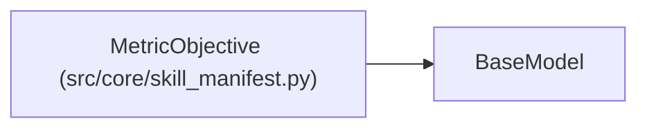

# MetricObjective

**Location:** `src/core/skill_manifest.py:317`
**Kind:** Pydantic model
**Bases:** `BaseModel`
**Module:** [skill_manifest](../modules/skill_manifest.md)

## Description

One objective metric inside a multiobjective declaration.

## Model Configuration

| Setting | Value | Source |
|---------|-------|--------|
| `extra` | `'forbid'` | model_config |

## Attributes

| Name | Type | Wire name | Required | Nullable | Default | Constraints | Examples | Description |
|------|------|-----------|----------|----------|---------|-------------|-------------|----------|
| `field` | `str` | `field` | Yes | No | — | — | — | — |
| `label` | `str` | `label` | Yes | No | — | — | — | — |
| `direction` | `Literal['higher_is_better', 'lower_is_better']` | `direction` | Yes | No | — | — | — | — |

## Methods

*No public methods. Inherits from base classes.*

## Relationships

<!-- Auto-generated relationship summary. Do not edit by hand. -->

### Summary

| Module | Methods | Attributes |
|---|---:|---|
| [skill_manifest](../modules/skill_manifest.md) | 0 | `direction`, `field`, `label` |

### Structure

| Kind | Entity | Module |
|---|---|---|
| Base | `BaseModel` | — |
