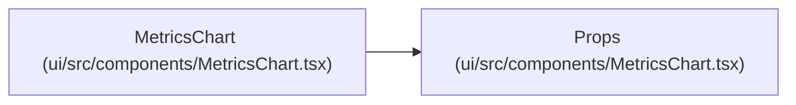

# Props

**Location:** `ui/src/components/MetricsChart.tsx:5`
**Kind:** Class
**Bases:** —
**Module:** [MetricsChart](../modules/MetricsChart.md)

## Description

_Auto-generated from `Props` in `ui/src/components/MetricsChart.tsx`._

## Attributes

| Name | Type | Required | Default | Description |
|------|------|----------|---------|-------------|
| `iterations` | `Iteration[]` | Yes | — | — |
| `selectedIteration` | `number \| null` | No | — | — |
| `onSelectIteration` | `(iteration: number) => void` | No | — | — |
| `chartSeries` | `MetricColumn[]` | No | — | — |

## Methods

*No public methods. Inherits from base classes.*

## Relationships

<!-- Auto-generated relationship summary. Do not edit by hand. -->

### Summary

| Module | Methods | Attributes |
|---|---:|---|
| [MetricsChart](../modules/MetricsChart.md) | 0 | `chartSeries`, `iterations`, `onSelectIteration`, `selectedIteration` |

### References

| Reference | Kind | Source | Call sites |
|---|---|---|---:|
| `MetricsChart` | type_reference | [MetricsChart](../modules/MetricsChart.md) | — |
