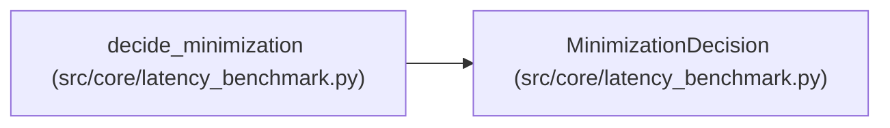

# MinimizationDecision

**Location:** `src/core/latency_benchmark.py:361`
**Kind:** Class
**Bases:** —
**Module:** [latency_benchmark](../modules/latency_benchmark.md)

**Decorators:** `@dataclass(frozen=True)`

## Description

Lower-is-better with guardrails: a winner only on qualified evidence.

## Attributes

| Name | Type | Default | Description |
|------|------|---------|-------------|
| `winner` | `Optional[str]` | *required* | — |
| `reason` | `str` | *required* | — |
| `comparable` | `bool` | *required* | — |
| `qualified` | `bool` | *required* | — |
| `improvement` | `float` | *required* | — |
| `guardrails` | `Mapping[str, bool]` | *required* | — |

## Methods

*No public methods. Inherits from base classes.*

## Relationships

<!-- Auto-generated relationship summary. Do not edit by hand. -->

### Summary

| Module | Methods | Attributes |
|---|---:|---|
| [latency_benchmark](../modules/latency_benchmark.md) | 0 | `comparable`, `guardrails`, `improvement`, `qualified`, `reason`, `winner` |

### References

| Reference | Kind | Source | Call sites |
|---|---|---|---:|
| `decide_minimization` | call | [latency_benchmark](../modules/latency_benchmark.md) | 4 |
| `decide_minimization` | type_reference | [latency_benchmark](../modules/latency_benchmark.md) | — |
