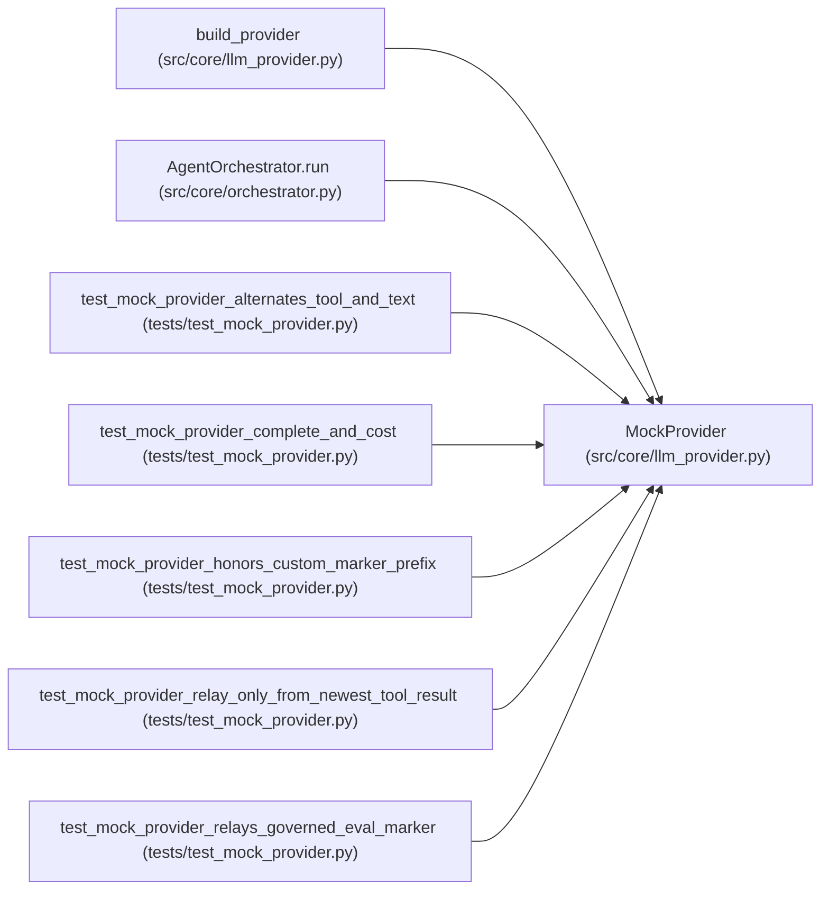

# MockProvider

**Location:** `src/core/llm_provider.py:913`
**Kind:** Class
**Bases:** —
**Module:** [llm_provider](../modules/llm_provider.md)

## Description

Zero-credential scripted provider for demos and CI (P0-3).

Replays a deterministic edit-run-keep loop without any network: each
``messages_create`` emits one ``bash`` tool call running the skill's eval
script, and — ARC-012 P7-011 — when the previous governed eval printed an
iteration marker on stdout, the *next* response relays that exact marker
line alongside a fresh eval call, exactly like a real agent (the
marker-relay contract: a marker is honored only in a turn that itself ran
a training command, and only the governed subprocess's verbatim output is
trustworthy — the mock invents no metrics). ``complete`` returns a canned
insight summary. Cost is always 0. Clearly labeled via ``name == "mock"``
so production code can refuse it.

## Attributes

*No annotated attributes found.*

## Methods

| Method | Signature | Decorators | Description |
|--------|-----------|------------|-------------|
| `__init__` | `(*, eval_command: str = '', marker_prefix: str = 'ITERATION_RESULT:') -> None` | — | — |
| `_last_tool_marker` | `(messages: list[Message]) -> str \| None` | — | The freshest iteration marker line in the most recent tool result. |
| `messages_create` | *(async)* `(*, model: str, system: str, messages: list[Message], tools: list[ToolDef], max_tokens: int, temperature: float \| None = None, stop_sequences: list[str] \| None = None) -> ProviderResponse` | — | — |
| `complete` | *(async)* `(*, model: str, prompt: str, max_tokens: int, system: str \| None = None) -> str` | — | — |
| `stream` | *(async)* `(**kwargs: Any) -> AsyncIterator[StreamDelta]` | — | — |
| `estimate_cost` | `(model: str, usage: Usage) -> float` | — | — |
| `capabilities` | `() -> ProviderCapabilities` | — | — |
| `classify_error` | `(exc: Exception) -> ErrorClass` | — | — |

## Relationships

<!-- Auto-generated relationship summary. Do not edit by hand. -->

### Summary

| Module | Methods | Attributes |
|---|---:|---|
| [llm_provider](../modules/llm_provider.md) | 8 | — |

### References

| Reference | Kind | Source | Call sites |
|---|---|---|---:|
| `build_provider` | call | [llm_provider](../modules/llm_provider.md) | 1 |
| `AgentOrchestrator.run` | call | [orchestrator](../modules/orchestrator.md) | 1 |
| `test_mock_provider_alternates_tool_and_text` | call | [test_mock_provider](../modules/test_mock_provider.md) | 1 |
| `test_mock_provider_complete_and_cost` | call | [test_mock_provider](../modules/test_mock_provider.md) | 1 |
| `test_mock_provider_honors_custom_marker_prefix` | call | [test_mock_provider](../modules/test_mock_provider.md) | 1 |
| `test_mock_provider_relay_only_from_newest_tool_result` | call | [test_mock_provider](../modules/test_mock_provider.md) | 1 |
| `test_mock_provider_relays_governed_eval_marker` | call | [test_mock_provider](../modules/test_mock_provider.md) | 1 |
