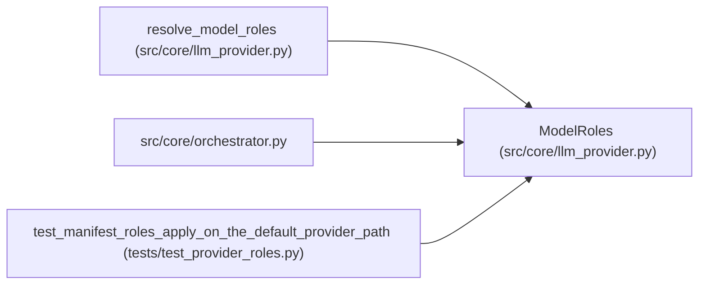

# ModelRoles

**Location:** `src/core/llm_provider.py:1350`
**Kind:** Class
**Bases:** —
**Module:** [llm_provider](../modules/llm_provider.md)

**Decorators:** `@dataclass(frozen=True)`

## Description

The effective model roles and output cap for a session.

## Attributes

| Name | Type | Default | Description |
|------|------|---------|-------------|
| `primary_model` | `str` | *required* | — |
| `insight_model` | `str` | *required* | — |
| `max_output_tokens` | `int` | *required* | — |

## Methods

*No public methods. Inherits from base classes.*

## Relationships

<!-- Auto-generated relationship summary. Do not edit by hand. -->

### Summary

| Module | Methods | Attributes |
|---|---:|---|
| [llm_provider](../modules/llm_provider.md) | 0 | `insight_model`, `max_output_tokens`, `primary_model` |

### References

| Reference | Kind | Source | Call sites |
|---|---|---|---:|
| `resolve_model_roles` | call | [llm_provider](../modules/llm_provider.md) | 1 |
| `resolve_model_roles` | type_reference | [llm_provider](../modules/llm_provider.md) | — |
| `orchestrator` | import | [orchestrator](../modules/orchestrator.md) | — |
| `test_manifest_roles_apply_on_the_default_provider_path` | call | [test_provider_roles](../modules/test_provider_roles.md) | 1 |
