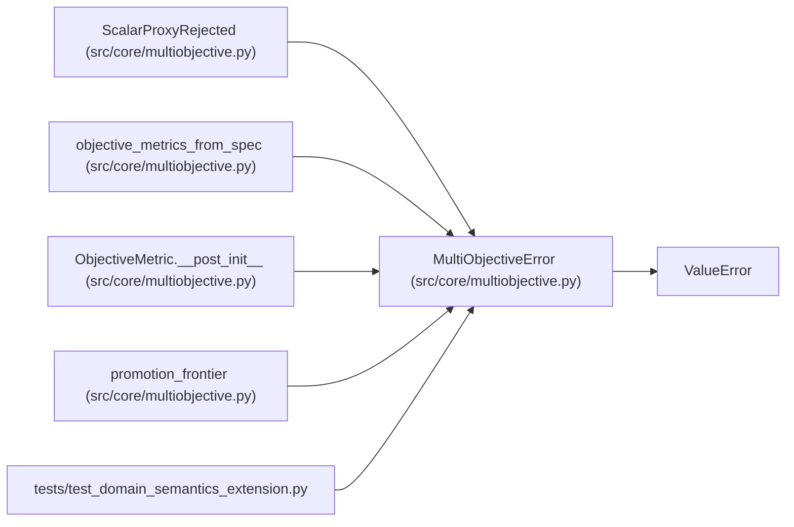

# MultiObjectiveError

**Location:** `src/core/multiobjective.py:21`
**Kind:** Class
**Bases:** `ValueError`
**Module:** [multiobjective](../modules/multiobjective.md)

## Description

Base error for multiobjective semantics (explicit, never silent).

## Attributes

*No annotated attributes found.*

## Methods

*No public methods. Inherits from base classes.*

## Relationships

<!-- Auto-generated relationship summary. Do not edit by hand. -->

### Summary

| Module | Methods | Attributes |
|---|---:|---|
| [multiobjective](../modules/multiobjective.md) | 0 | — |

### Structure

| Kind | Entity | Module |
|---|---|---|
| Base | `ValueError` | — |
| Subclass | `ScalarProxyRejected` | [multiobjective](../modules/multiobjective.md) |

### References

| Reference | Kind | Source | Call sites |
|---|---|---|---:|
| `objective_metrics_from_spec` | call | [multiobjective](../modules/multiobjective.md) | 1 |
| `ObjectiveMetric.__post_init__` | call | [multiobjective](../modules/multiobjective.md) | 1 |
| `promotion_frontier` | call | [multiobjective](../modules/multiobjective.md) | 1 |
| `test_domain_semantics_extension` | import | [test_domain_semantics_extension](../modules/test_domain_semantics_extension.md) | — |
