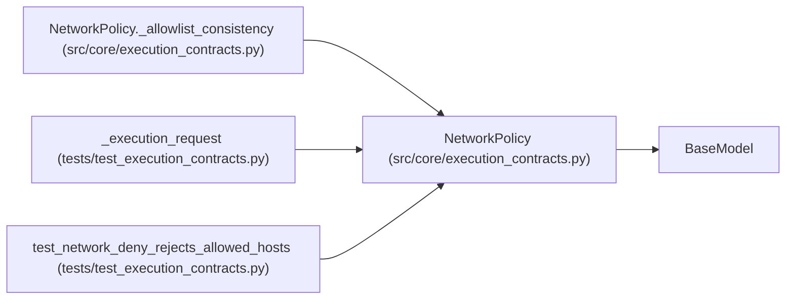

# NetworkPolicy

**Location:** `src/core/execution_contracts.py:678`
**Kind:** Pydantic model
**Bases:** `BaseModel`
**Module:** [execution_contracts](../modules/execution_contracts.md)

## Description

Network authority for one attempt; deny is the default posture.

## Model Configuration

| Setting | Value | Source |
|---------|-------|--------|
| `extra` | `'forbid'` | model_config |

## Validators

| Method | Scope | Fields | Mode | Options |
|--------|-------|--------|------|---------|
| `_allowlist_consistency` | model | — | after | — |

## Attributes

| Name | Type | Wire name | Required | Nullable | Default | Constraints | Examples | Description |
|------|------|-----------|----------|----------|---------|-------------|-------------|----------|
| `mode` | `Literal['deny', 'allowlist']` | `mode` | No | No | `'deny'` | — | — | — |
| `allowed_hosts` | `list[str]` | `allowed_hosts` | No | No | factory: `list` | — | — | — |

## Methods

| Method | Signature | Decorators | Description |
|--------|-----------|------------|-------------|
| `_allowlist_consistency` | `() -> 'NetworkPolicy'` | `@model_validator(mode='after')` | — |

## Relationships

<!-- Auto-generated relationship summary. Do not edit by hand. -->

### Summary

| Module | Methods | Attributes |
|---|---:|---|
| [execution_contracts](../modules/execution_contracts.md) | 1 | `allowed_hosts`, `mode` |

### Structure

| Kind | Entity | Module |
|---|---|---|
| Base | `BaseModel` | — |

### References

| Reference | Kind | Source | Call sites |
|---|---|---|---:|
| `NetworkPolicy._allowlist_consistency` | type_reference | [execution_contracts](../modules/execution_contracts.md) | — |
| `_execution_request` | call | [test_execution_contracts](../modules/test_execution_contracts.md) | 1 |
| `test_network_deny_rejects_allowed_hosts` | call | [test_execution_contracts](../modules/test_execution_contracts.md) | 1 |
