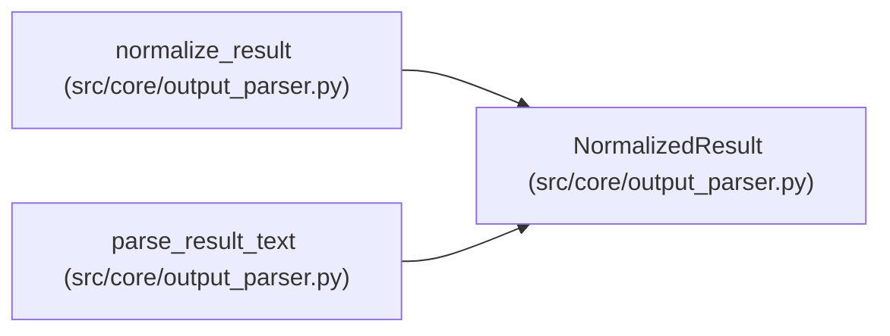

# NormalizedResult

**Location:** `src/core/output_parser.py:158`
**Kind:** Class
**Bases:** —
**Module:** [output_parser](../modules/output_parser.md)

**Decorators:** `@dataclass(frozen=True)`

## Description

One normalized result with its trusted raw evidence preserved.

``outcome`` is the semantics class: ``completed`` (may be a win),
``failed`` (declared failure status — non-winning, never carrying a
promotable metric), ``invalid`` (contract violations — explicit invalid
evidence, never implicit success). ``raw_evidence`` keeps the verbatim
parsed payload so audits can see exactly what the source said.

## Attributes

| Name | Type | Default | Description |
|------|------|---------|-------------|
| `outcome` | `str` | *required* | — |
| `status` | `Optional[str]` | *required* | — |
| `primary_metric` | `Optional[float]` | *required* | — |
| `metric_name` | `Optional[str]` | *required* | — |
| `direction` | `str` | *required* | — |
| `gates_passed` | `Optional[bool]` | *required* | — |
| `training_time_s` | `Optional[float]` | *required* | — |
| `fields` | `Mapping[str, Any]` | *required* | — |
| `units` | `Mapping[str, str]` | *required* | — |
| `raw_evidence` | `Mapping[str, Any]` | *required* | — |
| `violations` | `tuple[str, ...]` | *required* | — |

## Methods

| Method | Signature | Decorators | Description |
|--------|-----------|------------|-------------|
| `valid` | `() -> bool` | `@property` | — |
| `to_dict` | `() -> dict[str, Any]` | — | The record-facing dict (IterationMetrics shape + explicit flags). |

## Relationships

<!-- Auto-generated relationship summary. Do not edit by hand. -->

### Summary

| Module | Methods | Attributes |
|---|---:|---|
| [output_parser](../modules/output_parser.md) | 2 | `direction`, `fields`, `gates_passed`, `metric_name`, `outcome`, `primary_metric`, `raw_evidence`, `status`, `training_time_s`, `units`, `violations` |

### References

| Reference | Kind | Source | Call sites |
|---|---|---|---:|
| `normalize_result` | call | [output_parser](../modules/output_parser.md) | 1 |
| `normalize_result` | type_reference | [output_parser](../modules/output_parser.md) | — |
| `parse_result_text` | type_reference | [output_parser](../modules/output_parser.md) | — |
