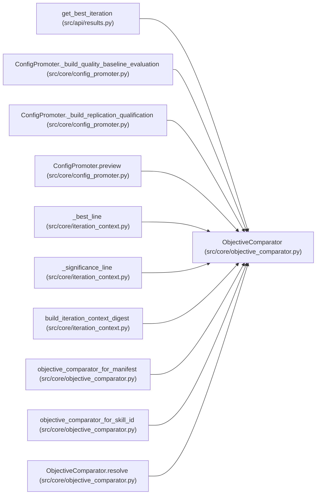

# ObjectiveComparator

**Location:** `src/core/objective_comparator.py:65`
**Kind:** Class
**Bases:** —
**Module:** [objective_comparator](../modules/objective_comparator.md)

**Decorators:** `@dataclass(frozen=True)`

## Description

The one rule for "is this result better than that one?".

## Attributes

| Name | Type | Default | Description |
|------|------|---------|-------------|
| `direction` | `ObjectiveDirection` | `'maximize'` | — |
| `epsilon` | `float` | `0.0` | — |
| `metric_field` | `str` | `'primary_metric'` | — |

## Methods

| Method | Signature | Decorators | Description |
|--------|-----------|------------|-------------|
| `__post_init__` | `() -> None` | — | — |
| `resolve` | `(*, policy: Any = None, direction: Optional[str] = None, epsilon: Optional[float] = None, metric_field: str = 'primary_metric') -> 'ObjectiveComparator'` | `@classmethod` | Resolve the one comparator for a decision path. |
| `orient` | `(candidate: Any, incumbent: Any) -> Optional[float]` | — | Signed gain of the candidate over the incumbent (+ = better). |
| `compare` | `(candidate: Any, incumbent: Any) -> Comparison` | — | better / tie / worse / incomparable, ties within ``epsilon``. |
| `is_better` | `(candidate: Any, incumbent: Any) -> bool` | — | Strict improvement beyond ``epsilon`` — the only way to move best. |

## Relationships

<!-- Auto-generated relationship summary. Do not edit by hand. -->

### Summary

| Module | Methods | Attributes |
|---|---:|---|
| [objective_comparator](../modules/objective_comparator.md) | 5 | `direction`, `epsilon`, `metric_field` |

### References

| Reference | Kind | Source | Call sites |
|---|---|---|---:|
| `get_best_iteration` | call | [results](../modules/results.md) | 1 |
| `ConfigPromoter._build_quality_baseline_evaluation` | call | [config_promoter](../modules/config_promoter.md) | 1 |
| `ConfigPromoter._build_quality_baseline_evaluation` | type_reference | [config_promoter](../modules/config_promoter.md) | — |
| `ConfigPromoter._build_replication_qualification` | type_reference | [config_promoter](../modules/config_promoter.md) | — |
| `ConfigPromoter.preview` | call | [config_promoter](../modules/config_promoter.md) | 1 |
| `_best_line` | type_reference | [iteration_context](../modules/iteration_context.md) | — |
| `_significance_line` | type_reference | [iteration_context](../modules/iteration_context.md) | — |
| `build_iteration_context_digest` | call | [iteration_context](../modules/iteration_context.md) | 1 |
| `objective_comparator_for_manifest` | type_reference | [objective_comparator](../modules/objective_comparator.md) | — |
| `objective_comparator_for_skill_id` | type_reference | [objective_comparator](../modules/objective_comparator.md) | — |
| `ObjectiveComparator.resolve` | call | [objective_comparator](../modules/objective_comparator.md) | 1 |
| `ObjectiveComparator.resolve` | type_reference | [objective_comparator](../modules/objective_comparator.md) | — |

> References: showing 12 of 62 logical references; 50 omitted by the 12-row generated summary limit.
