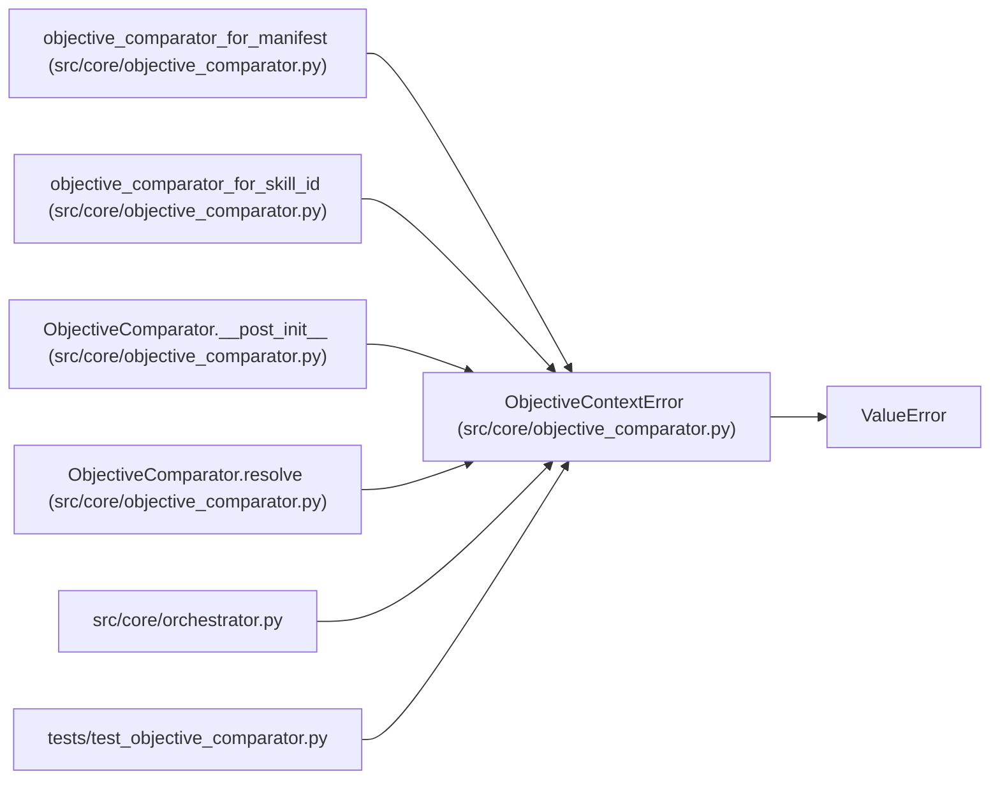

# ObjectiveContextError

**Location:** `src/core/objective_comparator.py:52`
**Kind:** Class
**Bases:** `ValueError`
**Module:** [objective_comparator](../modules/objective_comparator.md)

## Description

Raised when a comparison needs objective context that is not declared.

## Attributes

*No annotated attributes found.*

## Methods

*No public methods. Inherits from base classes.*

## Relationships

<!-- Auto-generated relationship summary. Do not edit by hand. -->

### Summary

| Module | Methods | Attributes |
|---|---:|---|
| [objective_comparator](../modules/objective_comparator.md) | 0 | — |

### Structure

| Kind | Entity | Module |
|---|---|---|
| Base | `ValueError` | — |

### References

| Reference | Kind | Source | Call sites |
|---|---|---|---:|
| `objective_comparator_for_manifest` | call | [objective_comparator](../modules/objective_comparator.md) | 1 |
| `objective_comparator_for_skill_id` | call | [objective_comparator](../modules/objective_comparator.md) | 2 |
| `ObjectiveComparator.__post_init__` | call | [objective_comparator](../modules/objective_comparator.md) | 3 |
| `ObjectiveComparator.resolve` | call | [objective_comparator](../modules/objective_comparator.md) | 1 |
| `orchestrator` | import | [orchestrator](../modules/orchestrator.md) | — |
| `test_objective_comparator` | import | [test_objective_comparator](../modules/test_objective_comparator.md) | — |
