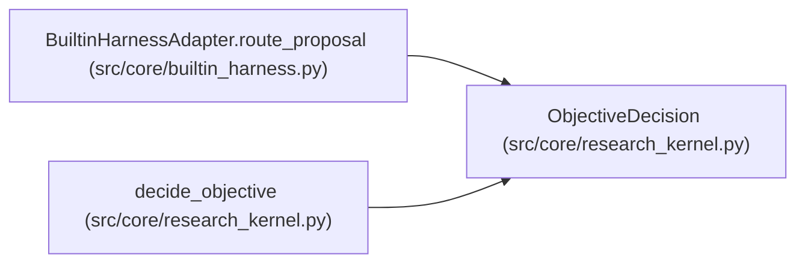

# ObjectiveDecision

**Location:** `src/core/research_kernel.py:38`
**Kind:** Class
**Bases:** —
**Module:** [research_kernel](../modules/research_kernel.md)

**Decorators:** `@dataclass(frozen=True)`

## Description

The adjudicated verdict and phase decision for one attempt.

## Attributes

| Name | Type | Default | Description |
|------|------|---------|-------------|
| `verdict` | `str` | *required* | — |
| `plan` | `str` | *required* | — |
| `phase_id` | `Optional[str]` | `None` | — |
| `phase_action` | `str` | `'stay'` | — |
| `reason` | `str` | `''` | — |

## Methods

*No public methods. Inherits from base classes.*

## Relationships

<!-- Auto-generated relationship summary. Do not edit by hand. -->

### Summary

| Module | Methods | Attributes |
|---|---:|---|
| [research_kernel](../modules/research_kernel.md) | 0 | `phase_action`, `phase_id`, `plan`, `reason`, `verdict` |

### References

| Reference | Kind | Source | Call sites |
|---|---|---|---:|
| `BuiltinHarnessAdapter.route_proposal` | type_reference | [builtin_harness](../modules/builtin_harness.md) | — |
| `decide_objective` | call | [research_kernel](../modules/research_kernel.md) | 1 |
| `decide_objective` | type_reference | [research_kernel](../modules/research_kernel.md) | — |
