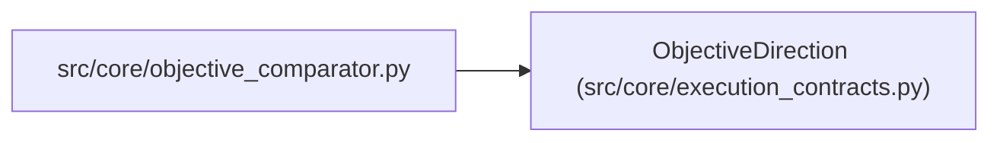

# ObjectiveDirection

**Location:** `src/core/execution_contracts.py:357`
**Kind:** Type alias
**Bases:** —
**Module:** [execution_contracts](../modules/execution_contracts.md)
**Target:** `Literal['minimize', 'maximize']`

## Description

_Auto-generated from `ObjectiveDirection` in `src/core/execution_contracts.py`._

## Attributes

*No annotated attributes found.*

## Methods

*No public methods. Inherits from base classes.*

## Relationships

<!-- Auto-generated relationship summary. Do not edit by hand. -->

### Summary

| Module | Methods | Attributes |
|---|---:|---|
| [execution_contracts](../modules/execution_contracts.md) | 0 | — |

### References

| Reference | Kind | Source | Call sites |
|---|---|---|---:|
| `objective_comparator` | import | [objective_comparator](../modules/objective_comparator.md) | — |
