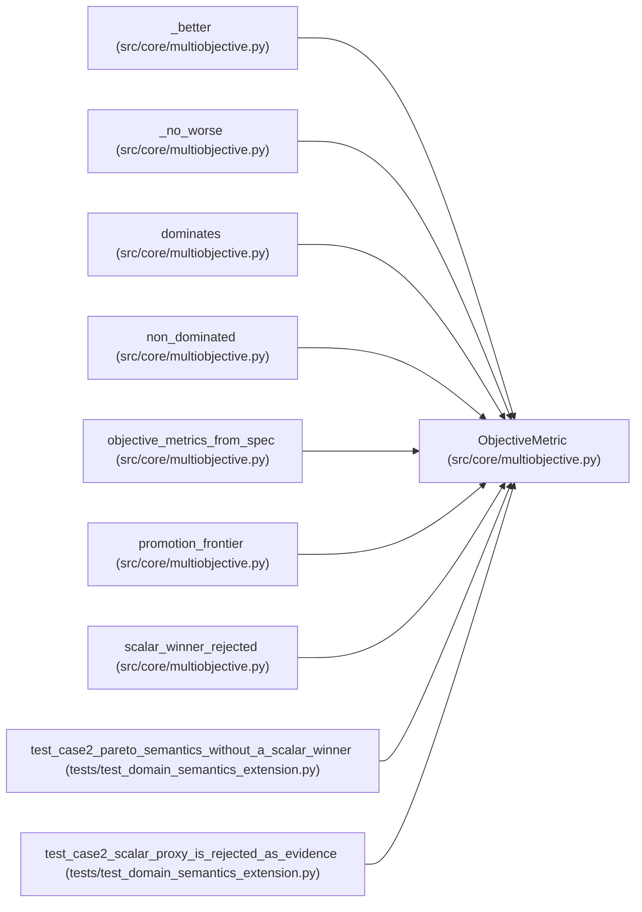

# ObjectiveMetric

**Location:** `src/core/multiobjective.py:30`
**Kind:** Class
**Bases:** —
**Module:** [multiobjective](../modules/multiobjective.md)

**Decorators:** `@dataclass(frozen=True)`

## Description

One declared objective metric: field name + direction.

## Attributes

| Name | Type | Default | Description |
|------|------|---------|-------------|
| `field` | `str` | *required* | — |
| `direction` | `str` | *required* | — |

## Methods

| Method | Signature | Decorators | Description |
|--------|-----------|------------|-------------|
| `__post_init__` | `() -> None` | — | — |

## Relationships

<!-- Auto-generated relationship summary. Do not edit by hand. -->

### Summary

| Module | Methods | Attributes |
|---|---:|---|
| [multiobjective](../modules/multiobjective.md) | 1 | `direction`, `field` |

### References

| Reference | Kind | Source | Call sites |
|---|---|---|---:|
| `_better` | type_reference | [multiobjective](../modules/multiobjective.md) | — |
| `_no_worse` | type_reference | [multiobjective](../modules/multiobjective.md) | — |
| `dominates` | type_reference | [multiobjective](../modules/multiobjective.md) | — |
| `non_dominated` | type_reference | [multiobjective](../modules/multiobjective.md) | — |
| `objective_metrics_from_spec` | call | [multiobjective](../modules/multiobjective.md) | 1 |
| `objective_metrics_from_spec` | type_reference | [multiobjective](../modules/multiobjective.md) | — |
| `promotion_frontier` | type_reference | [multiobjective](../modules/multiobjective.md) | — |
| `scalar_winner_rejected` | type_reference | [multiobjective](../modules/multiobjective.md) | — |
| `test_case2_pareto_semantics_without_a_scalar_winner` | call | [test_domain_semantics_extension](../modules/test_domain_semantics_extension.md) | 2 |
| `test_case2_scalar_proxy_is_rejected_as_evidence` | call | [test_domain_semantics_extension](../modules/test_domain_semantics_extension.md) | 2 |
