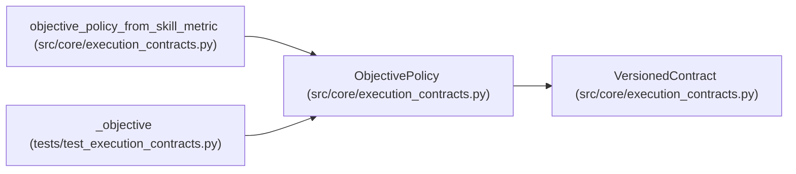

# ObjectivePolicy

**Location:** `src/core/execution_contracts.py:372`
**Kind:** Pydantic model
**Bases:** `VersionedContract`
**Module:** [execution_contracts](../modules/execution_contracts.md)

## Description

What counts as better, and what must hold for a result to be eligible.

``direction`` is authoritative for winner selection and ranking; ties
within ``tie_tolerance`` are ties, not silent wins for either side.

## Model Configuration

| Setting | Value | Source |
|---------|-------|--------|
| `extra` | `'forbid'` | model_config |
| `allow_inf_nan` | `False` | model_config |

## Attributes

| Name | Type | Wire name | Required | Nullable | Default | Constraints | Examples | Description |
|------|------|-----------|----------|----------|---------|-------------|-------------|----------|
| `schema_version` | `str` | `schema_version` | No | No | `OBJECTIVE_POLICY_SCHEMA_VERSION` | — | — | — |
| `metric_field` | `str` | `metric_field` | Yes | No | — | min_length=1 | — | — |
| `direction` | `ObjectiveDirection` | `direction` | Yes | No | — | — | — | — |
| `goal` | `ObjectiveGoal` | `goal` | No | No | `'optimize'` | — | — | — |
| `constraints` | `list[MetricConstraint]` | `constraints` | No | No | factory: `list` | — | — | — |
| `tie_tolerance` | `float` | `tie_tolerance` | No | No | `0.0` | ge=0.0 | — | — |

## Methods

*No public methods. Inherits from base classes.*

## Relationships

<!-- Auto-generated relationship summary. Do not edit by hand. -->

### Summary

| Module | Methods | Attributes |
|---|---:|---|
| [execution_contracts](../modules/execution_contracts.md) | 0 | `constraints`, `direction`, `goal`, `metric_field`, `schema_version`, `tie_tolerance` |

### Structure

| Kind | Entity | Module |
|---|---|---|
| Base | `VersionedContract` | [execution_contracts](../modules/execution_contracts.md) |

### References

| Reference | Kind | Source | Call sites |
|---|---|---|---:|
| `objective_policy_from_skill_metric` | call | [execution_contracts](../modules/execution_contracts.md) | 1 |
| `objective_policy_from_skill_metric` | type_reference | [execution_contracts](../modules/execution_contracts.md) | — |
| `_objective` | call | [test_execution_contracts](../modules/test_execution_contracts.md) | 1 |
