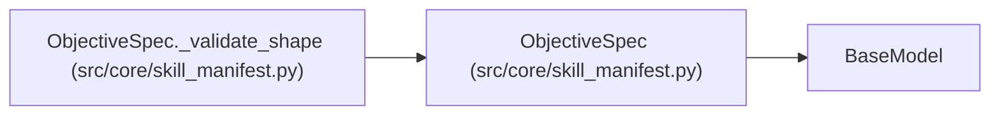

# ObjectiveSpec

**Location:** `src/core/skill_manifest.py:327`
**Kind:** Pydantic model
**Bases:** `BaseModel`
**Module:** [skill_manifest](../modules/skill_manifest.md)

## Description

Objective semantics: scalar (legacy) or multiobjective (Pareto).

``kind=scalar`` keeps the existing ``metric_schema.primary`` semantics
exactly. ``kind=multiobjective`` declares two or more metrics with their
own directions; results are compared as Pareto dominance and promotion
selects a non-dominated set — never a forced scalar winner. Unknown
objective kinds are rejected explicitly (closed vocabulary).

## Model Configuration

| Setting | Value | Source |
|---------|-------|--------|
| `extra` | `'forbid'` | model_config |

## Validators

| Method | Scope | Fields | Mode | Options |
|--------|-------|--------|------|---------|
| `_validate_shape` | model | — | after | — |

## Attributes

| Name | Type | Wire name | Required | Nullable | Default | Constraints | Examples | Description |
|------|------|-----------|----------|----------|---------|-------------|-------------|----------|
| `kind` | `Literal['scalar', 'multiobjective']` | `kind` | No | No | `'scalar'` | — | — | — |
| `metrics` | `list[MetricObjective]` | `metrics` | No | No | factory: `list` | — | — | — |

## Methods

| Method | Signature | Decorators | Description |
|--------|-----------|------------|-------------|
| `_validate_shape` | `() -> 'ObjectiveSpec'` | `@model_validator(mode='after')` | — |

## Relationships

<!-- Auto-generated relationship summary. Do not edit by hand. -->

### Summary

| Module | Methods | Attributes |
|---|---:|---|
| [skill_manifest](../modules/skill_manifest.md) | 1 | `kind`, `metrics` |

### Structure

| Kind | Entity | Module |
|---|---|---|
| Base | `BaseModel` | — |

### References

| Reference | Kind | Source | Call sites |
|---|---|---|---:|
| `ObjectiveSpec._validate_shape` | type_reference | [skill_manifest](../modules/skill_manifest.md) | — |
