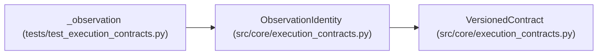

# ObservationIdentity

**Location:** `src/core/execution_contracts.py:302`
**Kind:** Pydantic model
**Bases:** `VersionedContract`
**Module:** [execution_contracts](../modules/execution_contracts.md)

## Description

Identity of one measured observation of a candidate.

The evaluation context (scorer, datasets, fidelity) is part of identity
so results from different contexts can never be compared as if they
measured the same thing.

## Model Configuration

| Setting | Value | Source |
|---------|-------|--------|
| `extra` | `'forbid'` | model_config |

## Validators

| Method | Scope | Fields | Mode | Options |
|--------|-------|--------|------|---------|
| `_digest_shape` | field | candidate_digest | after | — |
| `_dataset_digests_shape` | field | dataset_digests | after | — |

## Attributes

| Name | Type | Wire name | Required | Nullable | Default | Constraints | Examples | Description |
|------|------|-----------|----------|----------|---------|-------------|-------------|----------|
| `schema_version` | `str` | `schema_version` | No | No | `OBSERVATION_IDENTITY_SCHEMA_VERSION` | — | — | — |
| `observation_id` | `str` | `observation_id` | Yes | No | — | min_length=1 | — | — |
| `candidate_digest` | `str` | `candidate_digest` | Yes | No | — | — | — | — |
| `subject_id` | `str` | `subject_id` | Yes | No | — | min_length=1 | — | — |
| `variant` | `str` | `variant` | Yes | No | — | min_length=1 | — | — |
| `seed` | `Optional[int]` | `seed` | No | Yes | `None` | — | — | — |
| `scorer` | `ScorerRef` | `scorer` | Yes | No | — | — | — | — |
| `dataset_digests` | `list[str]` | `dataset_digests` | Yes | No | — | min_length=1 | — | — |
| `fidelity` | `Literal['measured', 'simulated']` | `fidelity` | Yes | No | — | — | — | — |

## Methods

| Method | Signature | Decorators | Description |
|--------|-----------|------------|-------------|
| `_digest_shape` | `(value: str) -> str` | `@field_validator('candidate_digest')`, `@classmethod` | — |
| `_dataset_digests_shape` | `(value: list[str]) -> list[str]` | `@field_validator('dataset_digests')`, `@classmethod` | — |
| `context_digest` | `() -> str` | — | Digest of the evaluation context — the comparability key. |

## Relationships

<!-- Auto-generated relationship summary. Do not edit by hand. -->

### Summary

| Module | Methods | Attributes |
|---|---:|---|
| [execution_contracts](../modules/execution_contracts.md) | 3 | `candidate_digest`, `dataset_digests`, `fidelity`, `observation_id`, `schema_version`, `scorer`, `seed`, `subject_id`, `variant` |

### Structure

| Kind | Entity | Module |
|---|---|---|
| Base | `VersionedContract` | [execution_contracts](../modules/execution_contracts.md) |

### References

| Reference | Kind | Source | Call sites |
|---|---|---|---:|
| `_observation` | call | [test_execution_contracts](../modules/test_execution_contracts.md) | 1 |
