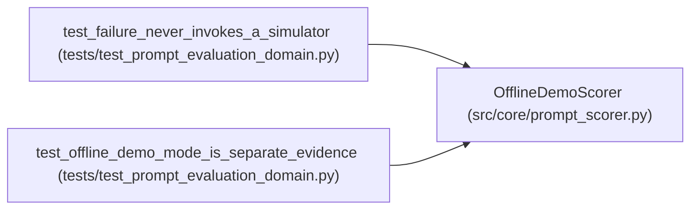

# OfflineDemoScorer

**Location:** `src/core/prompt_scorer.py:258`
**Kind:** Class
**Bases:** —
**Module:** [prompt_scorer](../modules/prompt_scorer.md)

## Description

The offline demo mode: clearly labeled, never qualification evidence.

## Attributes

*No annotated attributes found.*

## Methods

| Method | Signature | Decorators | Description |
|--------|-----------|------------|-------------|
| `__init__` | `() -> None` | — | — |
| `score` | `(request: Mapping[str, Any]) -> dict[str, Any]` | — | — |

## Relationships

<!-- Auto-generated relationship summary. Do not edit by hand. -->

### Summary

| Module | Methods | Attributes |
|---|---:|---|
| [prompt_scorer](../modules/prompt_scorer.md) | 2 | — |

### References

| Reference | Kind | Source | Call sites |
|---|---|---|---:|
| `test_failure_never_invokes_a_simulator` | call | [test_prompt_evaluation_domain](../modules/test_prompt_evaluation_domain.md) | 1 |
| `test_offline_demo_mode_is_separate_evidence` | call | [test_prompt_evaluation_domain](../modules/test_prompt_evaluation_domain.md) | 1 |
