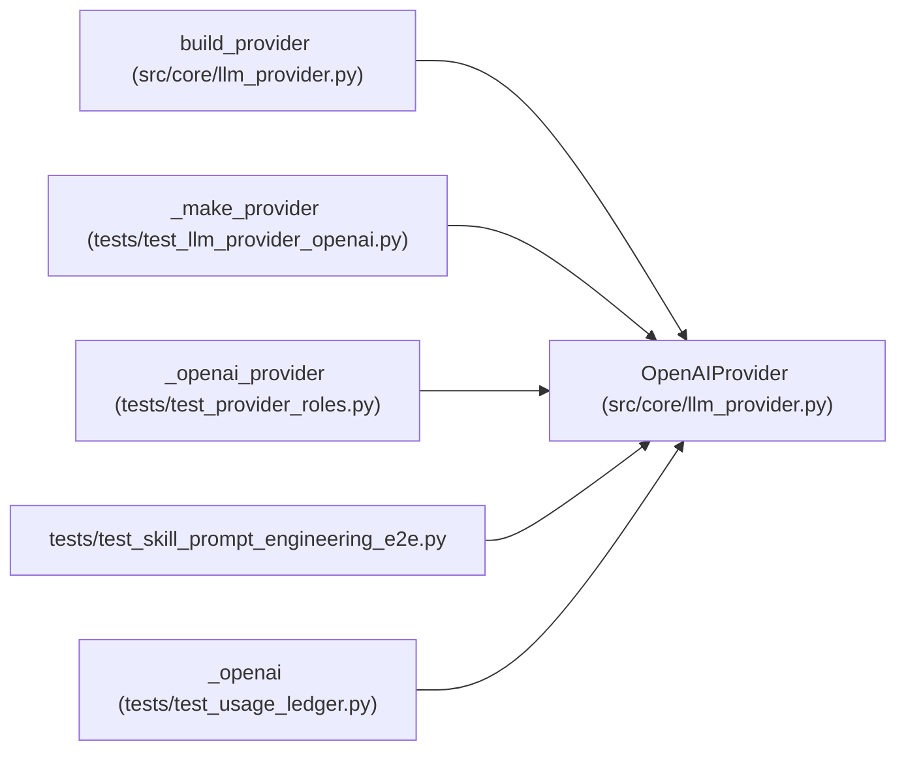

# OpenAIProvider

**Location:** `src/core/llm_provider.py:851`
**Kind:** Class
**Bases:** —
**Module:** [llm_provider](../modules/llm_provider.md)

## Description

``LLMProvider`` adapter over the OpenAI Chat Completions API (P4-007).

A boundary translator: normalized ``Message``/``ToolDef``/``system`` become
``chat.completions.create`` kwargs, and the raw ``ChatCompletion`` becomes a
normalized ``ProviderResponse``. The provider owns no retry — loop-owned
retry reads ``classify_error`` and decides backoff + the budget-aware skip.

The ``openai`` SDK is imported **lazily** in ``__init__`` so this module
imports without the package installed (tests that only exercise
``AnthropicProvider`` are unaffected). Constructing an ``OpenAIProvider``
requires ``openai >= 1.0``.

## Attributes

*No annotated attributes found.*

## Methods

| Method | Signature | Decorators | Description |
|--------|-----------|------------|-------------|
| `__init__` | `(*, base_url: str, api_key: str, timeout_s: float, provider_name: str = 'openai', zero_cost_fallback: bool = False) -> None` | — | — |
| `messages_create` | *(async)* `(*, model: str, system: str, messages: list[Message], tools: list[ToolDef], max_tokens: int, temperature: float \| None = None, stop_sequences: list[str] \| None = None) -> ProviderResponse` | — | One model turn via ``chat.completions.create``. |
| `complete` | *(async)* `(*, model: str, prompt: str, max_tokens: int, system: str \| None = None) -> str` | — | One-shot text completion (insights / Haiku path). |
| `stream` | *(async)* `(**kwargs: Any) -> AsyncIterator[StreamDelta]` | — | Token streaming (OPTIONAL in v1; D-stream). Not implemented for OpenAI. |
| `estimate_cost` | `(model: str, usage: Usage) -> float` | — | Per-model USD cost for an OpenAI or OpenAI-compatible call. |
| `price_quote` | `(model: str, usage: Usage) -> CostEstimate` | — | Basis-snapshotted OpenAI cost; unknown cloud models are unavailable, |
| `capabilities` | `() -> ProviderCapabilities` | — | — |
| `classify_error` | `(exc: Exception) -> ErrorClass` | — | Classify an OpenAI SDK exception for loop-owned retry. |

## Relationships

<!-- Auto-generated relationship summary. Do not edit by hand. -->

### Summary

| Module | Methods | Attributes |
|---|---:|---|
| [llm_provider](../modules/llm_provider.md) | 8 | — |

### References

| Reference | Kind | Source | Call sites |
|---|---|---|---:|
| `build_provider` | call | [llm_provider](../modules/llm_provider.md) | 1 |
| `_make_provider` | call | [test_llm_provider_openai](../modules/test_llm_provider_openai.md) | 1 |
| `_make_provider` | type_reference | [test_llm_provider_openai](../modules/test_llm_provider_openai.md) | — |
| `_openai_provider` | call | [test_provider_roles](../modules/test_provider_roles.md) | 1 |
| `test_skill_prompt_engineering_e2e` | import | [test_skill_prompt_engineering_e2e](../modules/test_skill_prompt_engineering_e2e.md) | — |
| `_openai` | call | [test_usage_ledger](../modules/test_usage_ledger.md) | 1 |
| `_openai` | type_reference | [test_usage_ledger](../modules/test_usage_ledger.md) | — |
