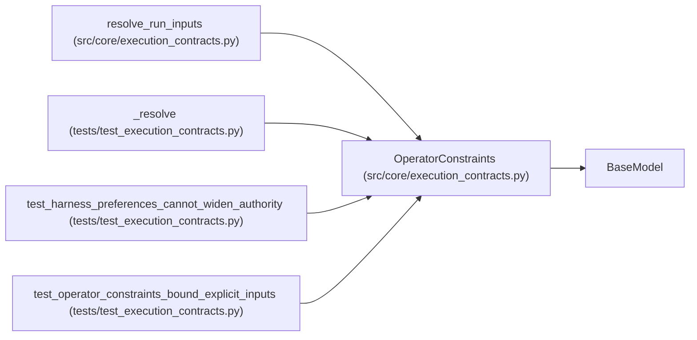

# OperatorConstraints

**Location:** `src/core/execution_contracts.py:956`
**Kind:** Pydantic model
**Bases:** `BaseModel`
**Module:** [execution_contracts](../modules/execution_contracts.md)

## Description

Authority bounds. Every resolved value falls inside these limits.

Constraints are ceilings, not values: they never supply defaults and no
lower-precedence layer (nor a harness preference) can widen them.

## Model Configuration

| Setting | Value | Source |
|---------|-------|--------|
| `extra` | `'forbid'` | model_config |
| `allow_inf_nan` | `False` | model_config |

## Validators

| Method | Scope | Fields | Mode | Options |
|--------|-------|--------|------|---------|
| `_capability_vocabulary` | field | allowed_capabilities | after | — |

## Attributes

| Name | Type | Wire name | Required | Nullable | Default | Constraints | Examples | Description |
|------|------|-----------|----------|----------|---------|-------------|-------------|----------|
| `max_iterations` | `Optional[int]` | `max_iterations` | No | Yes | `None` | ge=1 | — | — |
| `max_budget_usd` | `Optional[float]` | `max_budget_usd` | No | Yes | `None` | ge=0.0 | — | — |
| `timeout_s` | `Optional[int]` | `timeout_s` | No | Yes | `None` | ge=1 | — | — |
| `max_concurrency` | `Optional[int]` | `max_concurrency` | No | Yes | `None` | ge=1 | — | — |
| `allowed_capabilities` | `list[str]` | `allowed_capabilities` | No | No | factory: `list` | — | — | — |
| `allowed_integrations` | `list[IntegrationDirection]` | `allowed_integrations` | No | No | factory: `lambda: ['managed', 'attached']` | — | — | — |

## Methods

| Method | Signature | Decorators | Description |
|--------|-----------|------------|-------------|
| `_capability_vocabulary` | `(value: list[str]) -> list[str]` | `@field_validator('allowed_capabilities')`, `@classmethod` | — |

## Relationships

<!-- Auto-generated relationship summary. Do not edit by hand. -->

### Summary

| Module | Methods | Attributes |
|---|---:|---|
| [execution_contracts](../modules/execution_contracts.md) | 1 | `allowed_capabilities`, `allowed_integrations`, `max_budget_usd`, `max_concurrency`, `max_iterations`, `timeout_s` |

### Structure

| Kind | Entity | Module |
|---|---|---|
| Base | `BaseModel` | — |

### References

| Reference | Kind | Source | Call sites |
|---|---|---|---:|
| `resolve_run_inputs` | type_reference | [execution_contracts](../modules/execution_contracts.md) | — |
| `_resolve` | call | [test_execution_contracts](../modules/test_execution_contracts.md) | 1 |
| `test_harness_preferences_cannot_widen_authority` | call | [test_execution_contracts](../modules/test_execution_contracts.md) | 1 |
| `test_operator_constraints_bound_explicit_inputs` | call | [test_execution_contracts](../modules/test_execution_contracts.md) | 1 |
