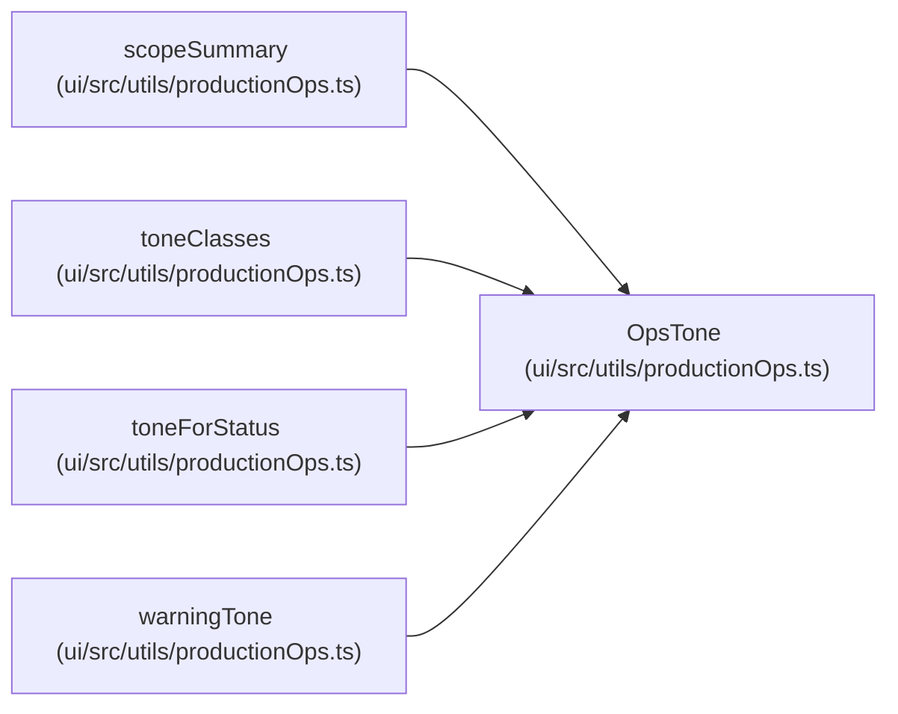

# OpsTone

**Location:** `ui/src/utils/productionOps.ts:1`
**Kind:** Type alias
**Bases:** —
**Module:** [productionOps](../modules/productionOps.md)

## Description

_Auto-generated from `OpsTone` in `ui/src/utils/productionOps.ts`._

## Attributes

*No annotated attributes found.*

## Methods

*No public methods. Inherits from base classes.*

## Relationships

<!-- Auto-generated relationship summary. Do not edit by hand. -->

### Summary

| Module | Methods | Attributes |
|---|---:|---|
| [productionOps](../modules/productionOps.md) | 0 | — |

### References

| Reference | Kind | Source | Call sites |
|---|---|---|---:|
| `scopeSummary` | type_reference | [productionOps](../modules/productionOps.md) | — |
| `toneClasses` | type_reference | [productionOps](../modules/productionOps.md) | — |
| `toneForStatus` | type_reference | [productionOps](../modules/productionOps.md) | — |
| `warningTone` | type_reference | [productionOps](../modules/productionOps.md) | — |
