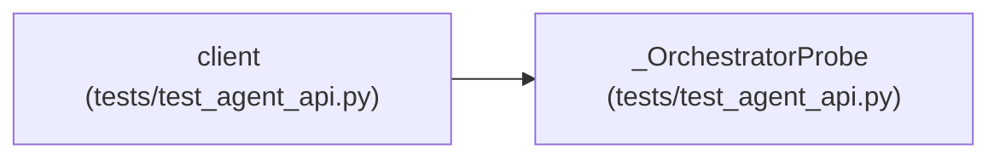

# _OrchestratorProbe

**Location:** `tests/test_agent_api.py:30`
**Kind:** Class
**Bases:** —
**Module:** [test_agent_api](../modules/test_agent_api.md)

## Description

_Auto-generated from `_OrchestratorProbe` in `tests/test_agent_api.py`._

## Attributes

*No annotated attributes found.*

## Methods

| Method | Signature | Decorators | Description |
|--------|-----------|------------|-------------|
| `__init__` | `()` | — | — |
| `request_pause` | `(research_id)` | — | — |
| `request_resume` | `(research_id)` | — | — |
| `request_stop` | `(research_id)` | — | — |

## Relationships

<!-- Auto-generated relationship summary. Do not edit by hand. -->

### Summary

| Module | Methods | Attributes |
|---|---:|---|
| [test_agent_api](../modules/test_agent_api.md) | 4 | — |

### References

| Reference | Kind | Source | Call sites |
|---|---|---|---:|
| `client` | call | [test_agent_api](../modules/test_agent_api.md) | 1 |
