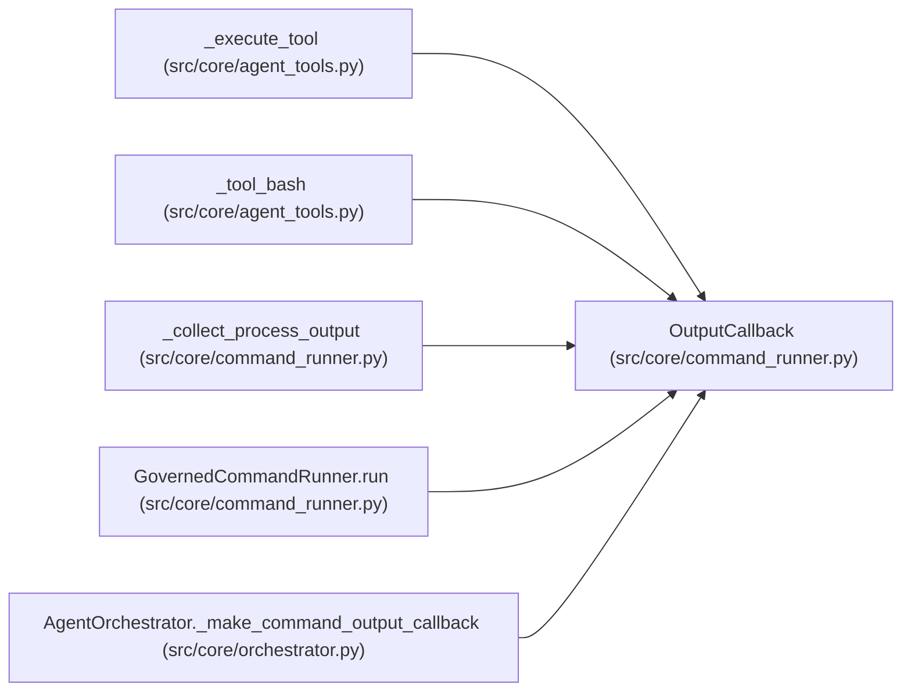

# OutputCallback

**Location:** `src/core/command_runner.py:253`
**Kind:** Type alias
**Bases:** —
**Module:** [command_runner](../modules/command_runner.md)
**Target:** `Callable[[OutputStream, str], None]`

## Description

_Auto-generated from `OutputCallback` in `src/core/command_runner.py`._

## Attributes

*No annotated attributes found.*

## Methods

*No public methods. Inherits from base classes.*

## Relationships

<!-- Auto-generated relationship summary. Do not edit by hand. -->

### Summary

| Module | Methods | Attributes |
|---|---:|---|
| [command_runner](../modules/command_runner.md) | 0 | — |

### References

| Reference | Kind | Source | Call sites |
|---|---|---|---:|
| `_execute_tool` | type_reference | [agent_tools](../modules/agent_tools.md) | — |
| `_tool_bash` | type_reference | [agent_tools](../modules/agent_tools.md) | — |
| `_collect_process_output` | type_reference | [command_runner](../modules/command_runner.md) | — |
| `GovernedCommandRunner.run` | type_reference | [command_runner](../modules/command_runner.md) | — |
| `AgentOrchestrator._make_command_output_callback` | type_reference | [orchestrator](../modules/orchestrator.md) | — |
