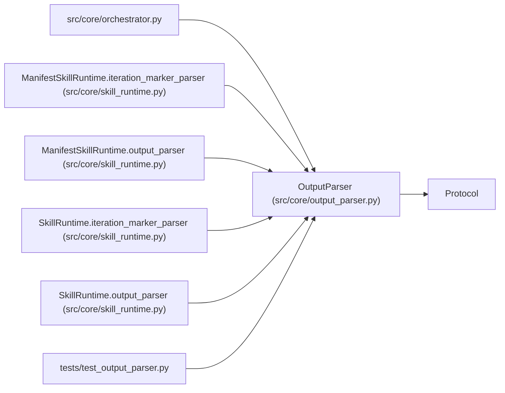

# OutputParser

**Location:** `src/core/output_parser.py:109`
**Kind:** Class
**Bases:** `Protocol`
**Module:** [output_parser](../modules/output_parser.md)

## Description

The experiment-output parsing contract (ARC-011 P1-010).

A concrete parser (``DelimitedKVParser`` for ``prepare.py`` stdout,
``JSONMarkerParser`` for ``ITERATION_RESULT:`` agent markers) implements
this surface. The orchestrator (P1-013) is wired to accept any
``OutputParser``.

``parse`` covers the ``---`` delimited KV-block form; ``parse_iteration``
covers the JSON-line-scan form. P4-003/P4-005 add ``nonce_field`` and
``require_signed_metrics`` parameters for the W11 anti-forgery contract:
when ``require_signed_metrics`` is true, the parser validates the echoed
nonce against ``session_nonce`` and rejects forged blocks.

## Attributes

*No annotated attributes found.*

## Methods

| Method | Signature | Decorators | Description |
|--------|-----------|------------|-------------|
| `parse` | `(raw_output: str) -> Optional[IterationResult]` | — | Parse a ``---`` delimited key:value block into a result dict. |
| `parse_iteration` | `(text: str, *, session_nonce: Optional[bytes] = None, config_snapshot: Optional[str] = None, nonce_field: Optional[str] = None, require_signed_metrics: bool = False) -> Optional[IterationResult]` | — | Scan agent text for an ``ITERATION_RESULT:`` JSON marker. |

## Relationships

<!-- Auto-generated relationship summary. Do not edit by hand. -->

### Summary

| Module | Methods | Attributes |
|---|---:|---|
| [output_parser](../modules/output_parser.md) | 2 | — |

### Structure

| Kind | Entity | Module |
|---|---|---|
| Base | `Protocol` | — |

### References

| Reference | Kind | Source | Call sites |
|---|---|---|---:|
| `orchestrator` | import | [orchestrator](../modules/orchestrator.md) | — |
| `ManifestSkillRuntime.iteration_marker_parser` | type_reference | [skill_runtime](../modules/skill_runtime.md) | — |
| `ManifestSkillRuntime.output_parser` | type_reference | [skill_runtime](../modules/skill_runtime.md) | — |
| `SkillRuntime.iteration_marker_parser` | type_reference | [skill_runtime](../modules/skill_runtime.md) | — |
| `SkillRuntime.output_parser` | type_reference | [skill_runtime](../modules/skill_runtime.md) | — |
| `test_output_parser` | import | [test_output_parser](../modules/test_output_parser.md) | — |
