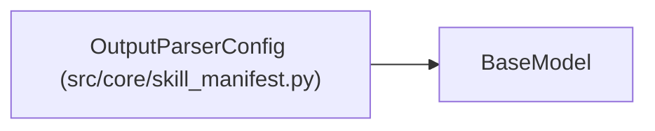

# OutputParserConfig

**Location:** `src/core/skill_manifest.py:573`
**Kind:** Pydantic model
**Bases:** `BaseModel`
**Module:** [skill_manifest](../modules/skill_manifest.md)

## Description

Parser contract (ARC-011 §9 ``output_parser``, G7). Reproduces
``experiment_parser.py`` literals.

## Model Configuration

| Setting | Value | Source |
|---------|-------|--------|
| `extra` | `'forbid'` | model_config |

## Attributes

| Name | Type | Wire name | Required | Nullable | Default | Constraints | Examples | Description |
|------|------|-----------|----------|----------|---------|-------------|-------------|----------|
| `format` | `ParserFormat` | `format` | Yes | No | — | — | — | — |
| `block_delimiter` | `str` | `block_delimiter` | No | No | `'---'` | — | — | — |
| `iteration_marker` | `str` | `iteration_marker` | No | No | `'ITERATION_RESULT:'` | — | — | — |
| `nonce_field` | `Optional[str]` | `nonce_field` | No | Yes | `None` | — | — | — |
| `require_signed_metrics` | `bool` | `require_signed_metrics` | No | No | `False` | — | — | — |
| `required_fields` | `list[str]` | `required_fields` | No | No | factory: `list` | — | — | — |
| `field_types` | `Optional[FieldTypes]` | `field_types` | No | Yes | `None` | — | — | — |
| `failure_statuses` | `list[str]` | `failure_statuses` | No | No | factory: `list` | — | — | — |
| `fallback` | `Optional[OutputParserFallback]` | `fallback` | No | Yes | `None` | — | — | — |

## Methods

*No public methods. Inherits from base classes.*

## Relationships

<!-- Auto-generated relationship summary. Do not edit by hand. -->

### Summary

| Module | Methods | Attributes |
|---|---:|---|
| [skill_manifest](../modules/skill_manifest.md) | 0 | `block_delimiter`, `failure_statuses`, `fallback`, `field_types`, `format`, `iteration_marker`, `nonce_field`, `require_signed_metrics`, `required_fields` |

### Structure

| Kind | Entity | Module |
|---|---|---|
| Base | `BaseModel` | — |
