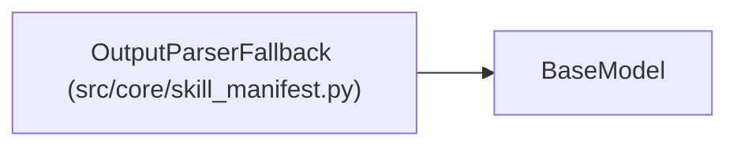

# OutputParserFallback

**Location:** `src/core/skill_manifest.py:528`
**Kind:** Pydantic model
**Bases:** `BaseModel`
**Module:** [skill_manifest](../modules/skill_manifest.md)

## Description

Fallback iteration sources when the primary parse yields nothing
(ARC-011 §9 ``output_parser.fallback``, G7).

## Model Configuration

| Setting | Value | Source |
|---------|-------|--------|
| `extra` | `'forbid'` | model_config |

## Attributes

| Name | Type | Wire name | Required | Nullable | Default | Constraints | Examples | Description |
|------|------|-----------|----------|----------|---------|-------------|-------------|----------|
| `read_marker_file` | `Optional[str]` | `read_marker_file` | No | Yes | `None` | — | — | Basename of the marker fallback (e.g. ``last_metrics.txt``). |
| `read_results_file` | `Optional[str]` | `read_results_file` | No | Yes | `None` | — | — | Basename of the JSON results fallback (e.g. ``results.json``). |
| `marker_dir_template` | `Optional[str]` | `marker_dir_template` | No | Yes | `None` | — | — | — |

## Methods

*No public methods. Inherits from base classes.*

## Relationships

<!-- Auto-generated relationship summary. Do not edit by hand. -->

### Summary

| Module | Methods | Attributes |
|---|---:|---|
| [skill_manifest](../modules/skill_manifest.md) | 0 | `marker_dir_template`, `read_marker_file`, `read_results_file` |

### Structure

| Kind | Entity | Module |
|---|---|---|
| Base | `BaseModel` | — |
