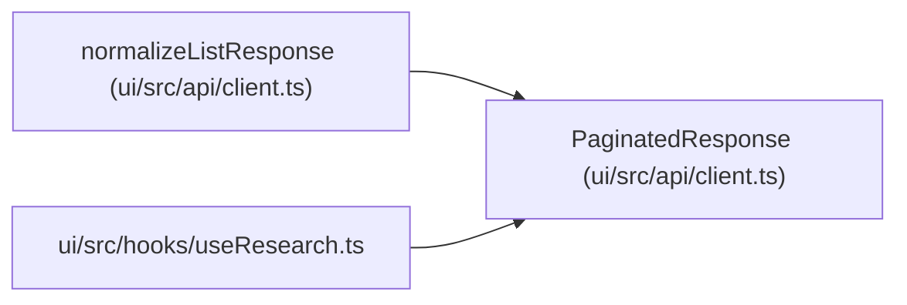

# PaginatedResponse

**Location:** `ui/src/api/client.ts:38`
**Kind:** Class
**Bases:** —
**Module:** [client](../modules/client.md)

## Description

_Auto-generated from `PaginatedResponse` in `ui/src/api/client.ts`._

## Attributes

| Name | Type | Required | Default | Description |
|------|------|----------|---------|-------------|
| `items` | `T[]` | Yes | — | — |
| `total` | `number` | Yes | — | — |
| `limit` | `number` | Yes | — | — |
| `offset` | `number` | Yes | — | — |

## Methods

*No public methods. Inherits from base classes.*

## Relationships

<!-- Auto-generated relationship summary. Do not edit by hand. -->

### Summary

| Module | Methods | Attributes |
|---|---:|---|
| [client](../modules/client.md) | 0 | `items`, `limit`, `offset`, `total` |

### References

| Reference | Kind | Source | Call sites |
|---|---|---|---:|
| `normalizeListResponse` | type_reference | [client](../modules/client.md) | — |
| `useResearch` | import | [useResearch](../modules/useResearch.md) | — |
