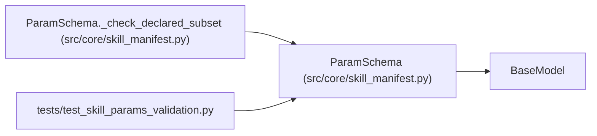

# ParamSchema

**Location:** `src/core/skill_manifest.py:232`
**Kind:** Pydantic model
**Bases:** `BaseModel`
**Module:** [skill_manifest](../modules/skill_manifest.md)

## Description

JSON Schema describing the ``skill_params`` a skill accepts (ARC-011
§9 ``param_schema``). Lifted from ``ResearchConfig`` flat fields + the HTTP
request bounds.

The inner schema is checked against the declared JSON Schema subset at
load time (:mod:`src.core.skill_params`) so an unsupported keyword can
never be silently ignored by the validator.

## Model Configuration

| Setting | Value | Source |
|---------|-------|--------|
| `extra` | `'allow'` | model_config |

## Validators

| Method | Scope | Fields | Mode | Options |
|--------|-------|--------|------|---------|
| `_check_declared_subset` | model | — | after | — |

## Attributes

| Name | Type | Wire name | Required | Nullable | Default | Constraints | Examples | Description |
|------|------|-----------|----------|----------|---------|-------------|-------------|----------|
| `type` | `Literal['object']` | `type` | No | No | `'object'` | — | — | — |
| `additionalProperties` | `bool` | `additionalProperties` | No | No | `False` | — | — | — |
| `properties` | `dict[str, ParamSchemaProperty]` | `properties` | No | No | factory: `dict` | — | — | — |
| `required` | `list[str]` | `required` | No | No | factory: `list` | — | — | — |

## Methods

| Method | Signature | Decorators | Description |
|--------|-----------|------------|-------------|
| `_check_declared_subset` | `() -> 'ParamSchema'` | `@model_validator(mode='after')` | — |

## Relationships

<!-- Auto-generated relationship summary. Do not edit by hand. -->

### Summary

| Module | Methods | Attributes |
|---|---:|---|
| [skill_manifest](../modules/skill_manifest.md) | 1 | `additionalProperties`, `properties`, `required`, `type` |

### Structure

| Kind | Entity | Module |
|---|---|---|
| Base | `BaseModel` | — |

### References

| Reference | Kind | Source | Call sites |
|---|---|---|---:|
| `ParamSchema._check_declared_subset` | type_reference | [skill_manifest](../modules/skill_manifest.md) | — |
| `test_skill_params_validation` | import | [test_skill_params_validation](../modules/test_skill_params_validation.md) | — |
