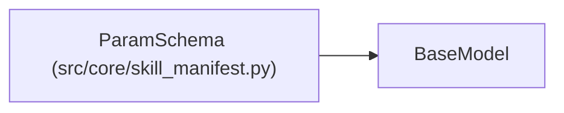

# ParamSchema

**Location:** `src/core/skill_manifest.py:228`
**Kind:** Pydantic model
**Bases:** `BaseModel`
**Module:** [skill_manifest](../modules/skill_manifest.md)

## Description

JSON Schema describing the ``skill_params`` a skill accepts (ARC-011
§9 ``param_schema``). Lifted from ``ResearchConfig`` flat fields + the HTTP
request bounds.

## Model Configuration

| Setting | Value | Source |
|---------|-------|--------|
| `extra` | `'allow'` | model_config |

## Attributes

| Name | Type | Wire name | Required | Nullable | Default | Constraints | Examples | Description |
|------|------|-----------|----------|----------|---------|-------------|-------------|----------|
| `type` | `Literal['object']` | `type` | No | No | `'object'` | — | — | — |
| `additionalProperties` | `bool` | `additionalProperties` | No | No | `False` | — | — | — |
| `properties` | `dict[str, ParamSchemaProperty]` | `properties` | No | No | factory: `dict` | — | — | — |
| `required` | `list[str]` | `required` | No | No | factory: `list` | — | — | — |

## Methods

*No public methods. Inherits from base classes.*

## Relationships

<!-- Auto-generated relationship summary. Do not edit by hand. -->

### Summary

| Module | Methods | Attributes |
|---|---:|---|
| [skill_manifest](../modules/skill_manifest.md) | 0 | `additionalProperties`, `properties`, `required`, `type` |

### Structure

| Kind | Entity | Module |
|---|---|---|
| Base | `BaseModel` | — |
