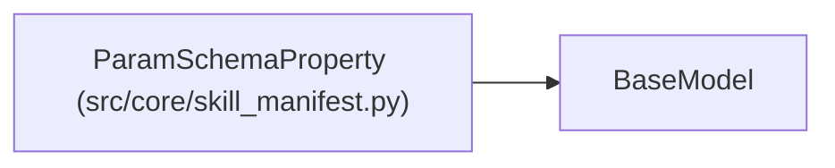

# ParamSchemaProperty

**Location:** `src/core/skill_manifest.py:219`
**Kind:** Pydantic model
**Bases:** `BaseModel`
**Module:** [skill_manifest](../modules/skill_manifest.md)

## Description

One property in the ``param_schema`` JSON Schema (a subset of JSON-Schema
draft-07 property descriptors is carried verbatim as a dict — P2-001 does
not re-validate the inner JSON Schema, only the wrapper).

## Model Configuration

| Setting | Value | Source |
|---------|-------|--------|
| `extra` | `'allow'` | model_config |

## Attributes

| Name | Type | Wire name | Required | Nullable | Default | Constraints | Examples | Description |
|------|------|-----------|----------|----------|---------|-------------|-------------|----------|
| `type` | `Optional[str]` | `type` | No | Yes | `None` | — | — | — |
| `default` | `Any` | `default` | No | No | `None` | — | — | — |
| `description` | `Optional[str]` | `description` | No | Yes | `None` | — | — | — |

## Methods

*No public methods. Inherits from base classes.*

## Relationships

<!-- Auto-generated relationship summary. Do not edit by hand. -->

### Summary

| Module | Methods | Attributes |
|---|---:|---|
| [skill_manifest](../modules/skill_manifest.md) | 0 | `default`, `description`, `type` |

### Structure

| Kind | Entity | Module |
|---|---|---|
| Base | `BaseModel` | — |
