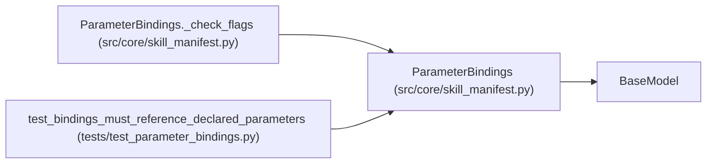

# ParameterBindings

**Location:** `src/core/skill_manifest.py:917`
**Kind:** Pydantic model
**Bases:** `BaseModel`
**Module:** [skill_manifest](../modules/skill_manifest.md)

## Description

Declarative bindings from resolved ``skill_params`` into actual work.

The binding contract (parameter-to-work traceability): a submitted
parameter reaches the bootstrap, the candidate initialization, the
evaluator argv, and the output metadata only through these declared
mappings — never through a core branch keyed on the skill name. Bound
flags are operator-owned at execution: model-authored argv can neither
change their values nor drop them (the execution-request resolver
rejects changes and supplies omissions).

## Model Configuration

| Setting | Value | Source |
|---------|-------|--------|
| `extra` | `'forbid'` | model_config |

## Validators

| Method | Scope | Fields | Mode | Options |
|--------|-------|--------|------|---------|
| `_check_flags` | model | — | after | — |

## Attributes

| Name | Type | Wire name | Required | Nullable | Default | Constraints | Examples | Description |
|------|------|-----------|----------|----------|---------|-------------|-------------|----------|
| `bootstrap_inputs` | `dict[str, str]` | `bootstrap_inputs` | No | No | factory: `dict` | — | — | — |
| `candidate_files` | `dict[str, str]` | `candidate_files` | No | No | factory: `dict` | — | — | — |
| `evaluator_flags` | `dict[str, str]` | `evaluator_flags` | No | No | factory: `dict` | — | — | — |
| `fixed_flags` | `dict[str, str]` | `fixed_flags` | No | No | factory: `dict` | — | — | — |
| `output_metadata` | `dict[str, str]` | `output_metadata` | No | No | factory: `dict` | — | — | — |

## Methods

| Method | Signature | Decorators | Description |
|--------|-----------|------------|-------------|
| `_check_flags` | `() -> 'ParameterBindings'` | `@model_validator(mode='after')` | — |

## Relationships

<!-- Auto-generated relationship summary. Do not edit by hand. -->

### Summary

| Module | Methods | Attributes |
|---|---:|---|
| [skill_manifest](../modules/skill_manifest.md) | 1 | `bootstrap_inputs`, `candidate_files`, `evaluator_flags`, `fixed_flags`, `output_metadata` |

### Structure

| Kind | Entity | Module |
|---|---|---|
| Base | `BaseModel` | — |

### References

| Reference | Kind | Source | Call sites |
|---|---|---|---:|
| `ParameterBindings._check_flags` | type_reference | [skill_manifest](../modules/skill_manifest.md) | — |
| `test_bindings_must_reference_declared_parameters` | call | [test_parameter_bindings](../modules/test_parameter_bindings.md) | 1 |
