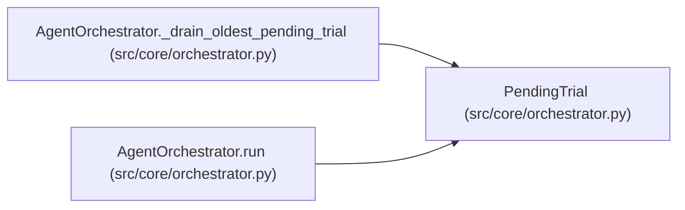

# PendingTrial

**Location:** `src/core/orchestrator.py:323`
**Kind:** Class
**Bases:** —
**Module:** [orchestrator](../modules/orchestrator.md)

**Decorators:** `@dataclass`

## Description

One deferred trial execution (P2 parallel-trial dispatch).

Pre-work (stage, snapshot, duplicate guard, runtime record) already ran
sequentially at the block's loop position; ``task`` runs the governed
subprocess. Finalization happens in block order at drain time via
``AgentOrchestrator._finalize_tool_result``.

## Attributes

| Name | Type | Default | Description |
|------|------|---------|-------------|
| `block_index` | `int` | *required* | — |
| `block` | `ToolUseBlock` | *required* | — |
| `task` | `asyncio.Task` | *required* | — |
| `trial_ctx` | `TrialContext` | *required* | — |
| `cmd_str` | `str` | *required* | — |
| `pending_snapshot` | `Optional[str]` | *required* | — |
| `runtime_command_id` | `Optional[int]` | *required* | — |
| `command_started_at` | `Optional[float]` | *required* | — |
| `tool_meta` | `Dict[str, Any]` | *required* | — |

## Methods

*No public methods. Inherits from base classes.*

## Relationships

<!-- Auto-generated relationship summary. Do not edit by hand. -->

### Summary

| Module | Methods | Attributes |
|---|---:|---|
| [orchestrator](../modules/orchestrator.md) | 0 | `block`, `block_index`, `cmd_str`, `command_started_at`, `pending_snapshot`, `runtime_command_id`, `task`, `tool_meta`, `trial_ctx` |

### References

| Reference | Kind | Source | Call sites |
|---|---|---|---:|
| `AgentOrchestrator._drain_oldest_pending_trial` | type_reference | [orchestrator](../modules/orchestrator.md) | — |
| `AgentOrchestrator.run` | call | [orchestrator](../modules/orchestrator.md) | 1 |
