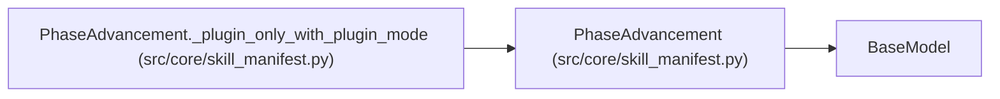

# PhaseAdvancement

**Location:** `src/core/skill_manifest.py:452`
**Kind:** Pydantic model
**Bases:** `BaseModel`
**Module:** [skill_manifest](../modules/skill_manifest.md)

## Description

Top-level phase-advancement mode (G1). When ``mode == plugin`` the
completion rule is owned by a sandboxed ``phases.py``; the declarative
``Phase`` fields above are its inputs.

## Model Configuration

| Setting | Value | Source |
|---------|-------|--------|
| `extra` | `'forbid'` | model_config |

## Validators

| Method | Scope | Fields | Mode | Options |
|--------|-------|--------|------|---------|
| `_plugin_only_with_plugin_mode` | model | — | after | — |

## Attributes

| Name | Type | Wire name | Required | Nullable | Default | Constraints | Examples | Description |
|------|------|-----------|----------|----------|---------|-------------|-------------|----------|
| `mode` | `AdvancementMode` | `mode` | No | No | `'declarative'` | — | — | — |
| `plugin` | `Optional[str]` | `plugin` | No | Yes | `None` | — | — | — |

## Methods

| Method | Signature | Decorators | Description |
|--------|-----------|------------|-------------|
| `_plugin_only_with_plugin_mode` | `() -> 'PhaseAdvancement'` | `@model_validator(mode='after')` | — |

## Relationships

<!-- Auto-generated relationship summary. Do not edit by hand. -->

### Summary

| Module | Methods | Attributes |
|---|---:|---|
| [skill_manifest](../modules/skill_manifest.md) | 1 | `mode`, `plugin` |

### Structure

| Kind | Entity | Module |
|---|---|---|
| Base | `BaseModel` | — |

### References

| Reference | Kind | Source | Call sites |
|---|---|---|---:|
| `PhaseAdvancement._plugin_only_with_plugin_mode` | type_reference | [skill_manifest](../modules/skill_manifest.md) | — |
