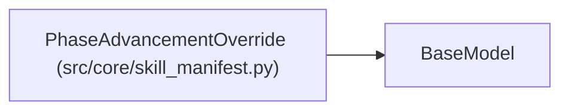

# PhaseAdvancementOverride

**Location:** `src/core/skill_manifest.py:348`
**Kind:** Pydantic model
**Bases:** `BaseModel`
**Module:** [skill_manifest](../modules/skill_manifest.md)

## Description

Per-phase advancement override (G1). Inherits the top-level mode when
omitted.

## Model Configuration

| Setting | Value | Source |
|---------|-------|--------|
| `extra` | `'forbid'` | model_config |

## Attributes

| Name | Type | Wire name | Required | Nullable | Default | Constraints | Examples | Description |
|------|------|-----------|----------|----------|---------|-------------|-------------|----------|
| `mode` | `AdvancementMode` | `mode` | Yes | No | — | — | — | — |
| `plugin` | `Optional[str]` | `plugin` | No | Yes | `None` | — | — | Relative path of the ``phases.py`` plugin (mode=plugin only). |

## Methods

*No public methods. Inherits from base classes.*

## Relationships

<!-- Auto-generated relationship summary. Do not edit by hand. -->

### Summary

| Module | Methods | Attributes |
|---|---:|---|
| [skill_manifest](../modules/skill_manifest.md) | 0 | `mode`, `plugin` |

### Structure

| Kind | Entity | Module |
|---|---|---|
| Base | `BaseModel` | — |
