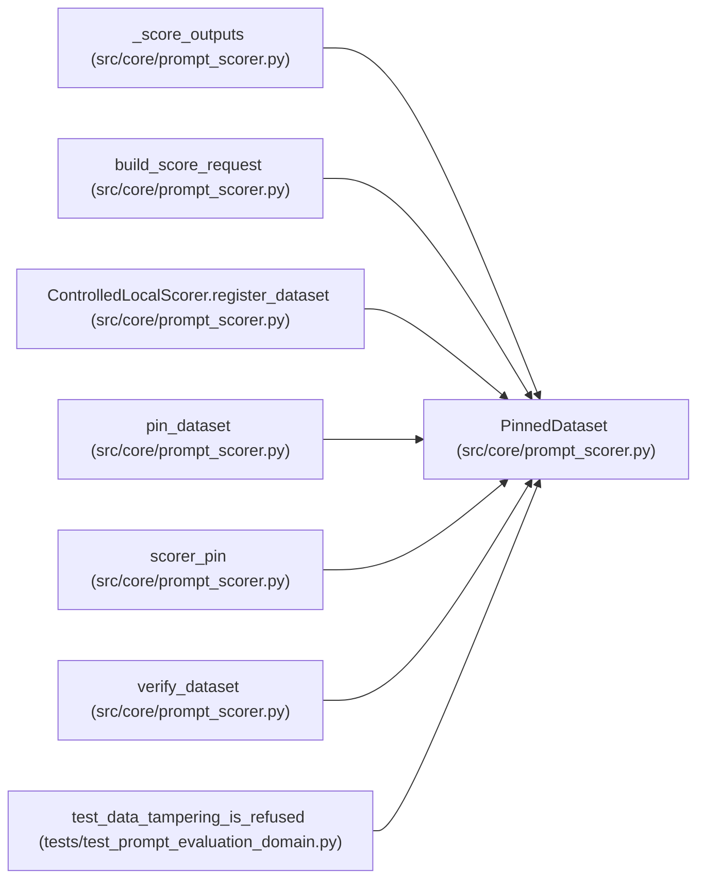

# PinnedDataset

**Location:** `src/core/prompt_scorer.py:52`
**Kind:** Class
**Bases:** —
**Module:** [prompt_scorer](../modules/prompt_scorer.md)

**Decorators:** `@dataclass(frozen=True)`

## Description

A digest-pinned evaluation split (train or holdout).

## Attributes

| Name | Type | Default | Description |
|------|------|---------|-------------|
| `role` | `str` | *required* | — |
| `dataset_id` | `str` | *required* | — |
| `digest` | `str` | *required* | — |
| `examples` | `tuple[Mapping[str, str], ...]` | *required* | — |

## Methods

| Method | Signature | Decorators | Description |
|--------|-----------|------------|-------------|
| `as_dict` | `() -> dict[str, Any]` | — | — |

## Relationships

<!-- Auto-generated relationship summary. Do not edit by hand. -->

### Summary

| Module | Methods | Attributes |
|---|---:|---|
| [prompt_scorer](../modules/prompt_scorer.md) | 1 | `dataset_id`, `digest`, `examples`, `role` |

### References

| Reference | Kind | Source | Call sites |
|---|---|---|---:|
| `_score_outputs` | type_reference | [prompt_scorer](../modules/prompt_scorer.md) | — |
| `build_score_request` | type_reference | [prompt_scorer](../modules/prompt_scorer.md) | — |
| `ControlledLocalScorer.register_dataset` | type_reference | [prompt_scorer](../modules/prompt_scorer.md) | — |
| `pin_dataset` | call | [prompt_scorer](../modules/prompt_scorer.md) | 1 |
| `pin_dataset` | type_reference | [prompt_scorer](../modules/prompt_scorer.md) | — |
| `scorer_pin` | type_reference | [prompt_scorer](../modules/prompt_scorer.md) | — |
| `verify_dataset` | type_reference | [prompt_scorer](../modules/prompt_scorer.md) | — |
| `test_data_tampering_is_refused` | call | [test_prompt_evaluation_domain](../modules/test_prompt_evaluation_domain.md) | 1 |
