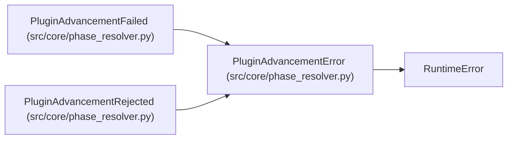

# PluginAdvancementError

**Location:** `src/core/phase_resolver.py:33`
**Kind:** Class
**Bases:** `RuntimeError`
**Module:** [phase_resolver](../modules/phase_resolver.md)

## Description

Base error for plugin phase advancement (explicit, fail-closed).

## Attributes

*No annotated attributes found.*

## Methods

*No public methods. Inherits from base classes.*

## Relationships

<!-- Auto-generated relationship summary. Do not edit by hand. -->

### Summary

| Module | Methods | Attributes |
|---|---:|---|
| [phase_resolver](../modules/phase_resolver.md) | 0 | — |

### Structure

| Kind | Entity | Module |
|---|---|---|
| Base | `RuntimeError` | — |
| Subclass | `PluginAdvancementFailed` | [phase_resolver](../modules/phase_resolver.md) |
| Subclass | `PluginAdvancementRejected` | [phase_resolver](../modules/phase_resolver.md) |
