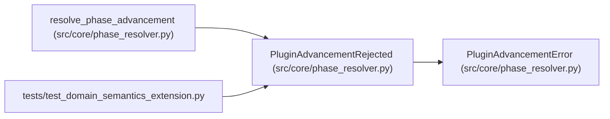

# PluginAdvancementRejected

**Location:** `src/core/phase_resolver.py:37`
**Kind:** Class
**Bases:** `PluginAdvancementError`
**Module:** [phase_resolver](../modules/phase_resolver.md)

## Description

The declaration itself is unsupported (explicit rejection).

## Attributes

*No annotated attributes found.*

## Methods

*No public methods. Inherits from base classes.*

## Relationships

<!-- Auto-generated relationship summary. Do not edit by hand. -->

### Summary

| Module | Methods | Attributes |
|---|---:|---|
| [phase_resolver](../modules/phase_resolver.md) | 0 | — |

### Structure

| Kind | Entity | Module |
|---|---|---|
| Base | `PluginAdvancementError` | [phase_resolver](../modules/phase_resolver.md) |

### References

| Reference | Kind | Source | Call sites |
|---|---|---|---:|
| `resolve_phase_advancement` | call | [phase_resolver](../modules/phase_resolver.md) | 2 |
| `test_domain_semantics_extension` | import | [test_domain_semantics_extension](../modules/test_domain_semantics_extension.md) | — |
