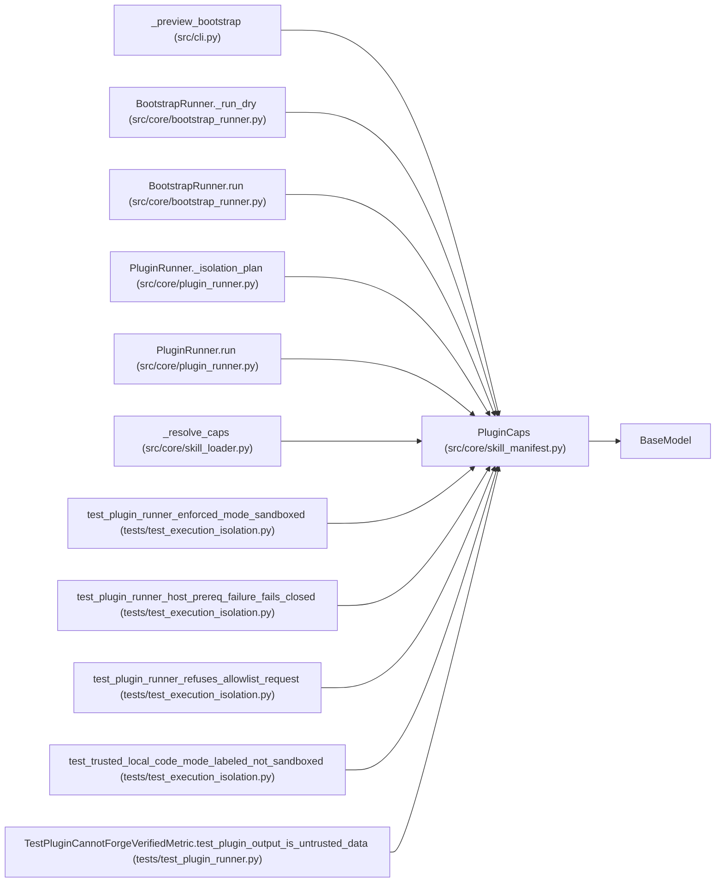

# PluginCaps

**Location:** `src/core/skill_manifest.py:451`
**Kind:** Pydantic model
**Bases:** `BaseModel`
**Module:** [skill_manifest](../modules/skill_manifest.md)

## Description

Capability block for one skill plugin (ARC-011 X-004 §6).

The governed ``PluginRunner`` (P5-005) reads these per-plugin caps to
build the subprocess environment / filesystem confinement before spawning.
Default-deny: anything not declared here is withheld. The contract is the
load-bearing input to P5-005 and P5-021 (generator safety).

Per-kind defaults are applied by the registry/loader when a skill omits a
``plugin`` entry but the corresponding file is present on disk
(X-004 §6 ``Default caps per kind``)::

    parser / resolve_identity → {fs_write: none, network_egress: [], env: []}
    preflight                 → {network_egress: [manifest health URLs]}
    bootstrap                 → {fs_write: workspace}

## Model Configuration

| Setting | Value | Source |
|---------|-------|--------|
| `extra` | `'forbid'` | model_config |

## Attributes

| Name | Type | Wire name | Required | Nullable | Default | Constraints | Examples | Description |
|------|------|-----------|----------|----------|---------|-------------|-------------|----------|
| `fs_write` | `Literal['workspace', 'none']` | `fs_write` | No | No | `'none'` | — | — | — |
| `network_egress` | `list[str]` | `network_egress` | No | No | factory: `list` | — | — | — |
| `env` | `list[str]` | `env` | No | No | factory: `list` | — | — | — |
| `timeout_s` | `float` | `timeout_s` | No | No | `30.0` | gt=0 | — | — |
| `max_rss_mb` | `int` | `max_rss_mb` | No | No | `512` | ge=1 | — | — |
| `max_cpu_s` | `float` | `max_cpu_s` | No | No | `30.0` | gt=0 | — | — |

## Methods

*No public methods. Inherits from base classes.*

## Relationships

<!-- Auto-generated relationship summary. Do not edit by hand. -->

### Summary

| Module | Methods | Attributes |
|---|---:|---|
| [skill_manifest](../modules/skill_manifest.md) | 0 | `env`, `fs_write`, `max_cpu_s`, `max_rss_mb`, `network_egress`, `timeout_s` |

### Structure

| Kind | Entity | Module |
|---|---|---|
| Base | `BaseModel` | — |

### References

| Reference | Kind | Source | Call sites |
|---|---|---|---:|
| `_preview_bootstrap` | call | [cli](../modules/cli.md) | 1 |
| `BootstrapRunner._run_dry` | type_reference | [bootstrap_runner](../modules/bootstrap_runner.md) | — |
| `BootstrapRunner.run` | call | [bootstrap_runner](../modules/bootstrap_runner.md) | 1 |
| `PluginRunner._isolation_plan` | type_reference | [plugin_runner](../modules/plugin_runner.md) | — |
| `PluginRunner.run` | type_reference | [plugin_runner](../modules/plugin_runner.md) | — |
| `_resolve_caps` | call | [skill_loader](../modules/skill_loader.md) | 1 |
| `_resolve_caps` | type_reference | [skill_loader](../modules/skill_loader.md) | — |
| `test_plugin_runner_enforced_mode_sandboxed` | call | [test_execution_isolation](../modules/test_execution_isolation.md) | 1 |
| `test_plugin_runner_host_prereq_failure_fails_closed` | call | [test_execution_isolation](../modules/test_execution_isolation.md) | 1 |
| `test_plugin_runner_refuses_allowlist_request` | call | [test_execution_isolation](../modules/test_execution_isolation.md) | 1 |
| `test_trusted_local_code_mode_labeled_not_sandboxed` | call | [test_execution_isolation](../modules/test_execution_isolation.md) | 1 |
| `TestPluginCannotForgeVerifiedMetric.test_plugin_output_is_untrusted_data` | call | [test_plugin_runner](../modules/test_plugin_runner.md) | 1 |

> References: showing 12 of 27 logical references; 15 omitted by the 12-row generated summary limit.
