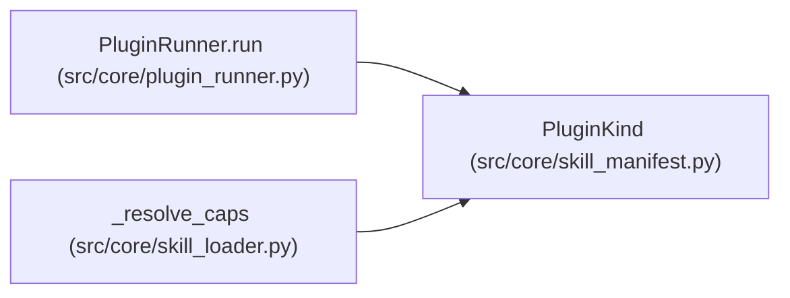

# PluginKind

**Location:** `src/core/skill_manifest.py:107`
**Kind:** Type alias
**Bases:** —
**Module:** [skill_manifest](../modules/skill_manifest.md)
**Target:** `Literal['parser', 'preflight', 'resolve_identity', 'bootstrap', 'phase_advancement']`

## Description

_Auto-generated from `PluginKind` in `src/core/skill_manifest.py`._

## Attributes

*No annotated attributes found.*

## Methods

*No public methods. Inherits from base classes.*

## Relationships

<!-- Auto-generated relationship summary. Do not edit by hand. -->

### Summary

| Module | Methods | Attributes |
|---|---:|---|
| [skill_manifest](../modules/skill_manifest.md) | 0 | — |

### References

| Reference | Kind | Source | Call sites |
|---|---|---|---:|
| `PluginRunner.run` | type_reference | [plugin_runner](../modules/plugin_runner.md) | — |
| `_resolve_caps` | type_reference | [skill_loader](../modules/skill_loader.md) | — |
