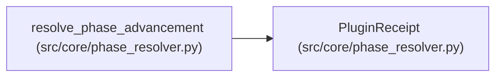

# PluginReceipt

**Location:** `src/core/phase_resolver.py:46`
**Kind:** Class
**Bases:** —
**Module:** [phase_resolver](../modules/phase_resolver.md)

**Decorators:** `@dataclass(frozen=True)`

## Description

Attempt-bound evidence of one resolver invocation.

## Attributes

| Name | Type | Default | Description |
|------|------|---------|-------------|
| `schema` | `str` | *required* | — |
| `plugin_path` | `str` | *required* | — |
| `attempt_id` | `str` | *required* | — |
| `input_digest` | `str` | *required* | — |
| `output_digest` | `str` | *required* | — |
| `caps_digest` | `str` | *required* | — |
| `plugin_schema_version` | `str` | *required* | — |

## Methods

| Method | Signature | Decorators | Description |
|--------|-----------|------------|-------------|
| `as_dict` | `() -> dict[str, Any]` | — | — |

## Relationships

<!-- Auto-generated relationship summary. Do not edit by hand. -->

### Summary

| Module | Methods | Attributes |
|---|---:|---|
| [phase_resolver](../modules/phase_resolver.md) | 1 | `attempt_id`, `caps_digest`, `input_digest`, `output_digest`, `plugin_path`, `plugin_schema_version`, `schema` |

### References

| Reference | Kind | Source | Call sites |
|---|---|---|---:|
| `resolve_phase_advancement` | call | [phase_resolver](../modules/phase_resolver.md) | 1 |
