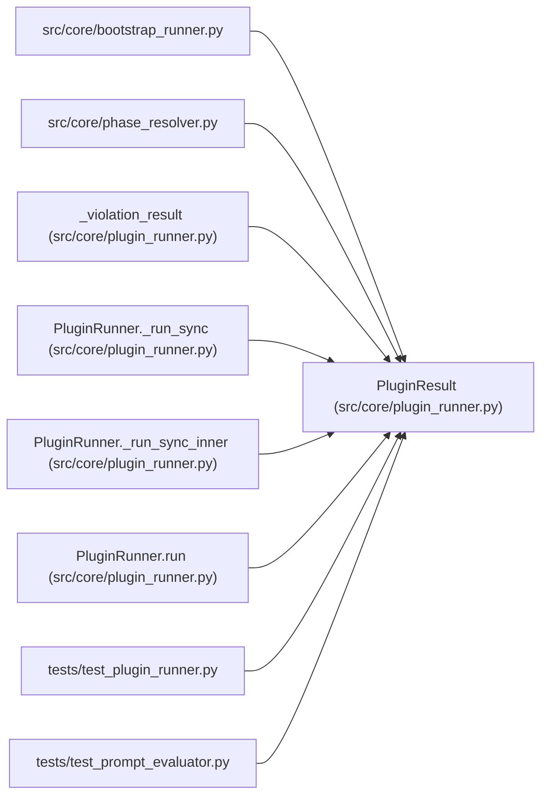

# PluginResult

**Location:** `src/core/plugin_runner.py:197`
**Kind:** Class
**Bases:** —
**Module:** [plugin_runner](../modules/plugin_runner.md)

**Decorators:** `@dataclass(frozen=True)`

## Description

Outcome of one plugin invocation (X-004 §6 failure semantics).

``ok=True`` ⇒ the plugin exited 0 and emitted valid JSON on stdout; the
parsed object is in ``output``. ``ok=False`` ⇒ crash / timeout / bad JSON /
non-zero exit; ``error`` carries the human-readable cause and the caller
writes a fail-closed ``audit_events`` row. The exception never propagates.

## Attributes

| Name | Type | Default | Description |
|------|------|---------|-------------|
| `ok` | `bool` | *required* | — |
| `kind` | `PluginKind` | *required* | — |
| `plugin_path` | `str` | *required* | — |
| `output` | `Optional[dict[str, Any]]` | `None` | — |
| `raw_output` | `str` | `''` | — |
| `returncode` | `Optional[int]` | `None` | — |
| `timed_out` | `bool` | `False` | — |
| `rss_exceeded` | `bool` | `False` | — |
| `cpu_exceeded` | `bool` | `False` | — |
| `processes_exceeded` | `bool` | `False` | — |
| `output_exceeded` | `bool` | `False` | — |
| `fsize_exceeded` | `bool` | `False` | — |
| `violation` | `Optional[str]` | `None` | — |
| `cleanup_incomplete` | `bool` | `False` | — |
| `error` | `Optional[str]` | `None` | — |
| `duration_s` | `float` | `0.0` | — |
| `caps` | `Optional[PluginCaps]` | `None` | — |
| `isolation` | `str` | `''` | — |
| `extra` | `dict[str, Any]` | `field(default_factory=dict)` | — |

## Methods

*No public methods. Inherits from base classes.*

## Relationships

<!-- Auto-generated relationship summary. Do not edit by hand. -->

### Summary

| Module | Methods | Attributes |
|---|---:|---|
| [plugin_runner](../modules/plugin_runner.md) | 0 | `caps`, `cleanup_incomplete`, `cpu_exceeded`, `duration_s`, `error`, `extra`, `fsize_exceeded`, `isolation`, `kind`, `ok`, `output`, `output_exceeded` |

### References

| Reference | Kind | Source | Call sites |
|---|---|---|---:|
| `bootstrap_runner` | import | [bootstrap_runner](../modules/bootstrap_runner.md) | — |
| `phase_resolver` | import | [phase_resolver](../modules/phase_resolver.md) | — |
| `_violation_result` | call | [plugin_runner](../modules/plugin_runner.md) | 1 |
| `_violation_result` | type_reference | [plugin_runner](../modules/plugin_runner.md) | — |
| `PluginRunner._run_sync` | type_reference | [plugin_runner](../modules/plugin_runner.md) | — |
| `PluginRunner._run_sync_inner` | call | [plugin_runner](../modules/plugin_runner.md) | 6 |
| `PluginRunner._run_sync_inner` | type_reference | [plugin_runner](../modules/plugin_runner.md) | — |
| `PluginRunner.run` | call | [plugin_runner](../modules/plugin_runner.md) | 4 |
| `PluginRunner.run` | type_reference | [plugin_runner](../modules/plugin_runner.md) | — |
| `test_plugin_runner` | import | [test_plugin_runner](../modules/test_plugin_runner.md) | — |
| `test_prompt_evaluator` | import | [test_prompt_evaluator](../modules/test_prompt_evaluator.md) | — |
