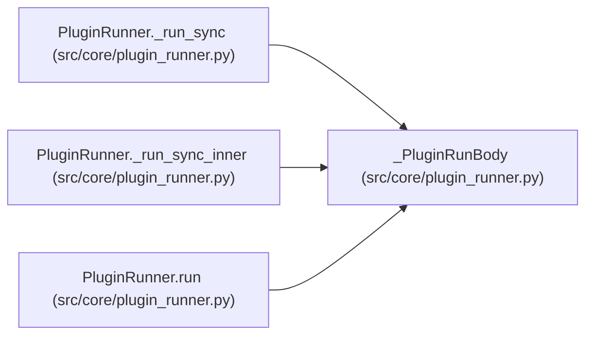

# _PluginRunBody

**Location:** `src/core/plugin_runner.py:481`
**Kind:** Class
**Bases:** —
**Module:** [plugin_runner](../modules/plugin_runner.md)

**Decorators:** `@dataclass`

## Description

Inputs bundled for the worker-thread sync body.

## Attributes

| Name | Type | Default | Description |
|------|------|---------|-------------|
| `plugin_path` | `Path` | *required* | — |
| `kind` | `PluginKind` | *required* | — |
| `plugin` | `str` | *required* | — |
| `input_json` | `dict[str, Any]` | *required* | — |
| `caps` | `PluginCaps` | *required* | — |
| `cwd` | `str` | *required* | — |
| `timeout_s` | `float` | *required* | — |
| `spawn_argv` | `list[str]` | *required* | — |
| `isolation` | `str` | *required* | — |

## Methods

*No public methods. Inherits from base classes.*

## Relationships

<!-- Auto-generated relationship summary. Do not edit by hand. -->

### Summary

| Module | Methods | Attributes |
|---|---:|---|
| [plugin_runner](../modules/plugin_runner.md) | 0 | `caps`, `cwd`, `input_json`, `isolation`, `kind`, `plugin`, `plugin_path`, `spawn_argv`, `timeout_s` |

### References

| Reference | Kind | Source | Call sites |
|---|---|---|---:|
| `PluginRunner._run_sync` | type_reference | [plugin_runner](../modules/plugin_runner.md) | — |
| `PluginRunner._run_sync_inner` | type_reference | [plugin_runner](../modules/plugin_runner.md) | — |
| `PluginRunner.run` | call | [plugin_runner](../modules/plugin_runner.md) | 1 |
