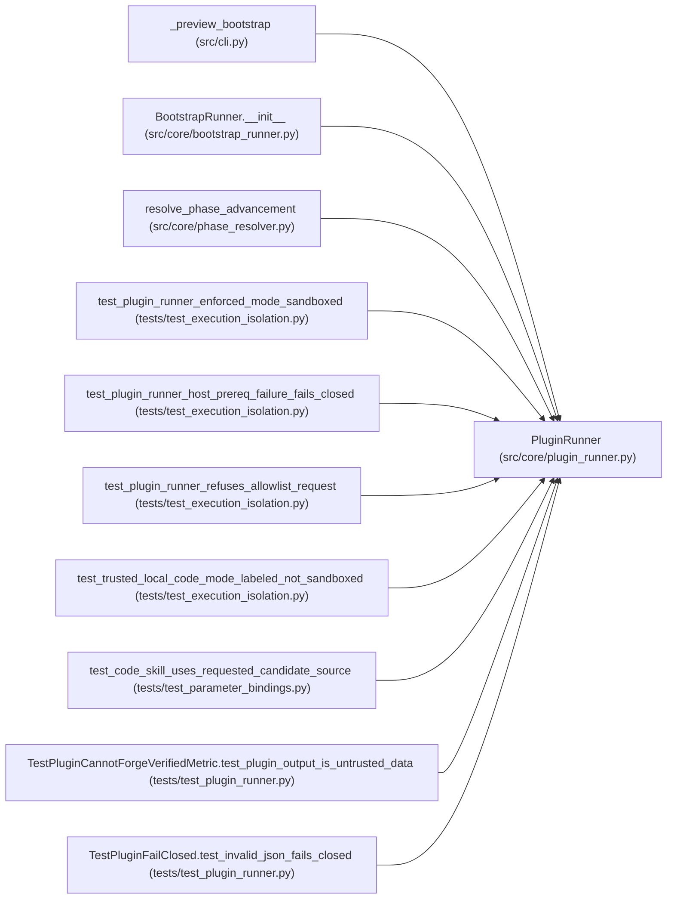

# PluginRunner

**Location:** `src/core/plugin_runner.py:242`
**Kind:** Class
**Bases:** —
**Module:** [plugin_runner](../modules/plugin_runner.md)

## Description

Execute one skill plugin in a confined governed subprocess (X-004 §6).

Parameters
----------
skills_root:
    Read-only skills directory (``PluginRunner`` never writes here; D4).

## Attributes

*No annotated attributes found.*

## Methods

| Method | Signature | Decorators | Description |
|--------|-----------|------------|-------------|
| `__init__` | `(*, skills_root: Optional[Path] = None) -> None` | — | — |
| `run` | *(async)* `(*, skill_dir: Path, plugin: str, kind: PluginKind, input_json: dict[str, Any], caps: PluginCaps, workspace: Optional[Path] = None, timeout_s: Optional[float] = None, proc_registry: Any = None, research_id: Optional[str] = None) -> PluginResult` | — | Run one plugin. See module docstring for the contract. |
| `_isolation_plan` | `(*, skill_dir: Path, caps: PluginCaps, cwd: str, base_argv: list[str], input_json: dict[str, Any]) -> tuple[str, list[str], Optional[str]]` | — | Decide the execution boundary for one plugin run. |
| `_run_sync` | `(body: '_PluginRunBody') -> PluginResult` | — | — |
| `_run_sync_inner` | `(body: '_PluginRunBody') -> PluginResult` | — | — |

## Relationships

<!-- Auto-generated relationship summary. Do not edit by hand. -->

### Summary

| Module | Methods | Attributes |
|---|---:|---|
| [plugin_runner](../modules/plugin_runner.md) | 5 | — |

### References

| Reference | Kind | Source | Call sites |
|---|---|---|---:|
| `_preview_bootstrap` | call | [cli](../modules/cli.md) | 1 |
| `BootstrapRunner.__init__` | call | [bootstrap_runner](../modules/bootstrap_runner.md) | 1 |
| `BootstrapRunner.__init__` | type_reference | [bootstrap_runner](../modules/bootstrap_runner.md) | — |
| `resolve_phase_advancement` | call | [phase_resolver](../modules/phase_resolver.md) | 1 |
| `resolve_phase_advancement` | type_reference | [phase_resolver](../modules/phase_resolver.md) | — |
| `test_plugin_runner_enforced_mode_sandboxed` | call | [test_execution_isolation](../modules/test_execution_isolation.md) | 1 |
| `test_plugin_runner_host_prereq_failure_fails_closed` | call | [test_execution_isolation](../modules/test_execution_isolation.md) | 1 |
| `test_plugin_runner_refuses_allowlist_request` | call | [test_execution_isolation](../modules/test_execution_isolation.md) | 1 |
| `test_trusted_local_code_mode_labeled_not_sandboxed` | call | [test_execution_isolation](../modules/test_execution_isolation.md) | 1 |
| `test_code_skill_uses_requested_candidate_source` | call | [test_parameter_bindings](../modules/test_parameter_bindings.md) | 1 |
| `TestPluginCannotForgeVerifiedMetric.test_plugin_output_is_untrusted_data` | call | [test_plugin_runner](../modules/test_plugin_runner.md) | 1 |
| `TestPluginFailClosed.test_invalid_json_fails_closed` | call | [test_plugin_runner](../modules/test_plugin_runner.md) | 1 |

> References: showing 12 of 25 logical references; 13 omitted by the 12-row generated summary limit.
