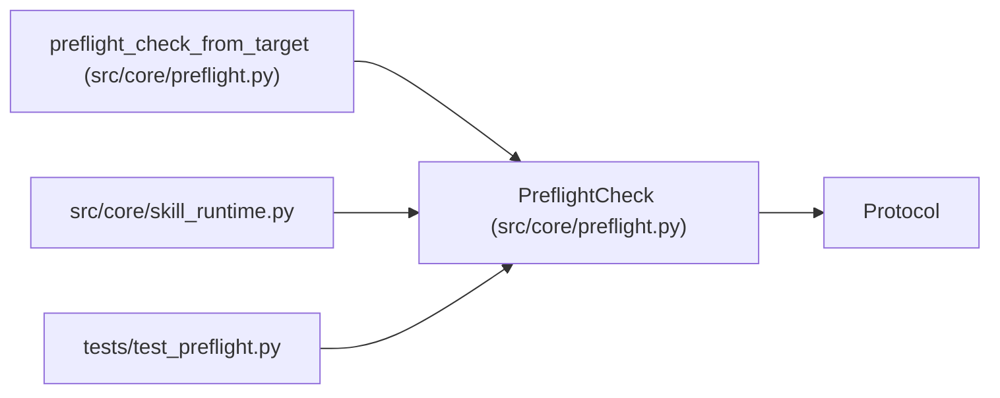

# PreflightCheck

**Location:** `src/core/preflight.py:50`
**Kind:** Class
**Bases:** `Protocol`
**Module:** [preflight](../modules/preflight.md)

## Description

A single service-dependency health check (ARC-011 P1-019).

A concrete check (``HTTPHealthCheck`` / ``TCPConnectCheck`` in P1-020)
implements this surface. ``run_service_preflight`` (P1-021) dispatches a
list of ``PreflightCheck`` instances via ``check(client)``.

The ``client`` arg is the shared ``httpx.AsyncClient`` for HTTP checks; TCP
checks ignore it (they open their own socket) — see ``TCPConnectCheck``.

## Attributes

*No annotated attributes found.*

## Methods

| Method | Signature | Decorators | Description |
|--------|-----------|------------|-------------|
| `name` | `() -> str` | `@property` | — |
| `required` | `() -> bool` | `@property` | — |
| `check` | *(async)* `(client: httpx.AsyncClient \| None) -> dict[str, Any]` | — | Run the health check, returning a result dict shaped like |

## Relationships

<!-- Auto-generated relationship summary. Do not edit by hand. -->

### Summary

| Module | Methods | Attributes |
|---|---:|---|
| [preflight](../modules/preflight.md) | 3 | — |

### Structure

| Kind | Entity | Module |
|---|---|---|
| Base | `Protocol` | — |

### References

| Reference | Kind | Source | Call sites |
|---|---|---|---:|
| `preflight_check_from_target` | type_reference | [preflight](../modules/preflight.md) | — |
| `skill_runtime` | import | [skill_runtime](../modules/skill_runtime.md) | — |
| `test_preflight` | import | [test_preflight](../modules/test_preflight.md) | — |
