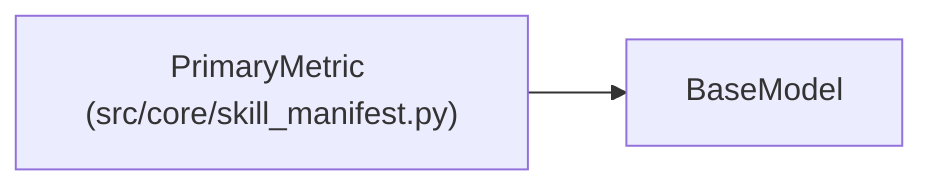

# PrimaryMetric

**Location:** `src/core/skill_manifest.py:246`
**Kind:** Pydantic model
**Bases:** `BaseModel`
**Module:** [skill_manifest](../modules/skill_manifest.md)

## Description

The primary optimization metric (ARC-011 §9 ``metric_schema.primary``).

## Model Configuration

| Setting | Value | Source |
|---------|-------|--------|
| `extra` | `'forbid'` | model_config |

## Attributes

| Name | Type | Wire name | Required | Nullable | Default | Constraints | Examples | Description |
|------|------|-----------|----------|----------|---------|-------------|-------------|----------|
| `field` | `str` | `field` | Yes | No | — | — | — | — |
| `label` | `str` | `label` | Yes | No | — | — | — | — |
| `direction` | `Literal['higher_is_better', 'lower_is_better']` | `direction` | Yes | No | — | — | — | — |
| `format` | `Optional[str]` | `format` | No | Yes | `None` | — | — | e.g. ``.4f``, ``duration_seconds``. |
| `primary_metric_jsonpath` | `Optional[list[str]]` | `primary_metric_jsonpath` | No | Yes | `None` | — | — | — |

## Methods

*No public methods. Inherits from base classes.*

## Relationships

<!-- Auto-generated relationship summary. Do not edit by hand. -->

### Summary

| Module | Methods | Attributes |
|---|---:|---|
| [skill_manifest](../modules/skill_manifest.md) | 0 | `direction`, `field`, `format`, `label`, `primary_metric_jsonpath` |

### Structure

| Kind | Entity | Module |
|---|---|---|
| Base | `BaseModel` | — |
