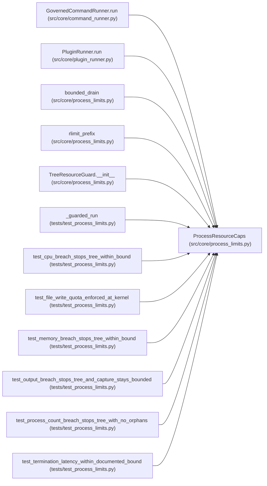

# ProcessResourceCaps

**Location:** `src/core/process_limits.py:63`
**Kind:** Class
**Bases:** —
**Module:** [process_limits](../modules/process_limits.md)

**Decorators:** `@dataclass(frozen=True)`

## Description

Finite resource caps for one candidate-controlled subprocess tree.

``None`` means the cap is not requested for this run. Every configured
value is enforced at the OS boundary or the parent boundary as described
in the module docstring; unenforceable configured caps raise
:class:`UnenforceableResourceCapabilityError` at spawn time.

## Attributes

| Name | Type | Default | Description |
|------|------|---------|-------------|
| `wall_s` | `Optional[float]` | `None` | — |
| `cpu_s` | `Optional[float]` | `None` | — |
| `rss_mb` | `Optional[int]` | `None` | — |
| `max_processes` | `Optional[int]` | `None` | — |
| `max_output_bytes` | `Optional[int]` | `None` | — |
| `max_file_write_bytes` | `Optional[int]` | `None` | — |

## Methods

*No public methods. Inherits from base classes.*

## Relationships

<!-- Auto-generated relationship summary. Do not edit by hand. -->

### Summary

| Module | Methods | Attributes |
|---|---:|---|
| [process_limits](../modules/process_limits.md) | 0 | `cpu_s`, `max_file_write_bytes`, `max_output_bytes`, `max_processes`, `rss_mb`, `wall_s` |

### References

| Reference | Kind | Source | Call sites |
|---|---|---|---:|
| `GovernedCommandRunner.run` | call | [command_runner](../modules/command_runner.md) | 1 |
| `PluginRunner.run` | call | [plugin_runner](../modules/plugin_runner.md) | 1 |
| `bounded_drain` | type_reference | [process_limits](../modules/process_limits.md) | — |
| `rlimit_prefix` | type_reference | [process_limits](../modules/process_limits.md) | — |
| `TreeResourceGuard.__init__` | type_reference | [process_limits](../modules/process_limits.md) | — |
| `_guarded_run` | type_reference | [test_process_limits](../modules/test_process_limits.md) | — |
| `test_cpu_breach_stops_tree_within_bound` | call | [test_process_limits](../modules/test_process_limits.md) | 1 |
| `test_file_write_quota_enforced_at_kernel` | call | [test_process_limits](../modules/test_process_limits.md) | 1 |
| `test_memory_breach_stops_tree_within_bound` | call | [test_process_limits](../modules/test_process_limits.md) | 1 |
| `test_output_breach_stops_tree_and_capture_stays_bounded` | call | [test_process_limits](../modules/test_process_limits.md) | 1 |
| `test_process_count_breach_stops_tree_with_no_orphans` | call | [test_process_limits](../modules/test_process_limits.md) | 1 |
| `test_termination_latency_within_documented_bound` | call | [test_process_limits](../modules/test_process_limits.md) | 1 |

> References: showing 12 of 14 logical references; 2 omitted by the 12-row generated summary limit.
