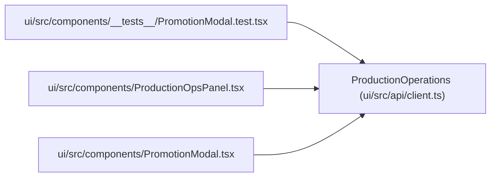

# ProductionOperations

**Location:** `ui/src/api/client.ts:312`
**Kind:** Class
**Bases:** —
**Module:** [client](../modules/client.md)

## Description

_Auto-generated from `ProductionOperations` in `ui/src/api/client.ts`._

## Attributes

| Name | Type | Required | Default | Description |
|------|------|----------|---------|-------------|
| `schema_version` | `string` | Yes | — | — |
| `research_id` | `string` | Yes | — | — |
| `model_type` | `string` | Yes | — | — |
| `candidate` | `ProductionCandidate \| null` | Yes | — | — |
| `promotion` | `{     blocked: boolean;     blockers: string[];     blocker_details: BlockerDetail[];     latest_scope?: PromotionScope \| null;     latest_record?: CompactPromotion \| null;     scopes: PromotionScopeStatus[];   }` | Yes | — | — |
| `warnings` | `ProductionWarning[]` | Yes | — | — |
| `rl_profit` | `RlProfitSummary` | Yes | — | — |
| `feature_readiness` | `FeatureReadinessSummary` | Yes | — | — |
| `oos_provenance` | `OosProvenanceSummary` | Yes | — | — |
| `inference_parity` | `InferenceParitySummary` | Yes | — | — |
| `rollback` | `RollbackStatusSummary` | Yes | — | — |
| `audit_events` | `ProductionAuditEvent[]` | Yes | — | — |

## Methods

*No public methods. Inherits from base classes.*

## Relationships

<!-- Auto-generated relationship summary. Do not edit by hand. -->

### Summary

| Module | Methods | Attributes |
|---|---:|---|
| [client](../modules/client.md) | 0 | `audit_events`, `candidate`, `feature_readiness`, `inference_parity`, `model_type`, `oos_provenance`, `promotion`, `research_id`, `rl_profit`, `rollback`, `schema_version`, `warnings` |

### References

| Reference | Kind | Source | Call sites |
|---|---|---|---:|
| `PromotionModal.test` | import | [PromotionModal.test](../modules/PromotionModal.test.md) | — |
| `ProductionOpsPanel` | import | [ProductionOpsPanel](../modules/ProductionOpsPanel.md) | — |
| `PromotionModal` | import | [PromotionModal](../modules/PromotionModal.md) | — |
