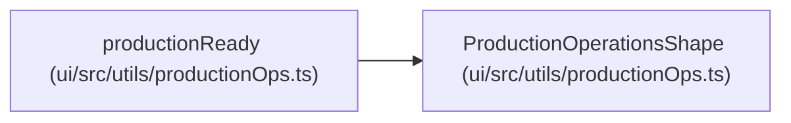

# ProductionOperationsShape

**Location:** `ui/src/utils/productionOps.ts:25`
**Kind:** Class
**Bases:** —
**Module:** [productionOps](../modules/productionOps.md)

## Description

_Auto-generated from `ProductionOperationsShape` in `ui/src/utils/productionOps.ts`._

## Attributes

| Name | Type | Required | Default | Description |
|------|------|----------|---------|-------------|
| `promotion` | `{     scopes: Array<{ scope: PromotionScopeName; status: string }>;   }` | Yes | — | — |

## Methods

*No public methods. Inherits from base classes.*

## Relationships

<!-- Auto-generated relationship summary. Do not edit by hand. -->

### Summary

| Module | Methods | Attributes |
|---|---:|---|
| [productionOps](../modules/productionOps.md) | 0 | `promotion` |

### References

| Reference | Kind | Source | Call sites |
|---|---|---|---:|
| `productionReady` | type_reference | [productionOps](../modules/productionOps.md) | — |
