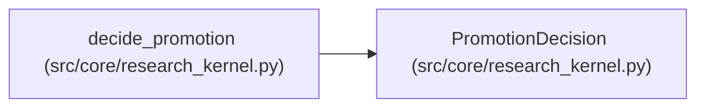

# PromotionDecision

**Location:** `src/core/research_kernel.py:66`
**Kind:** Class
**Bases:** —
**Module:** [research_kernel](../modules/research_kernel.md)

**Decorators:** `@dataclass(frozen=True)`

## Description

Promotion eligibility for the run's best candidate.

## Attributes

| Name | Type | Default | Description |
|------|------|---------|-------------|
| `eligible` | `bool` | *required* | — |
| `status` | `str` | *required* | — |
| `reasons` | `tuple[str, ...]` | `()` | — |
| `best_iteration` | `Optional[int]` | `None` | — |

## Methods

*No public methods. Inherits from base classes.*

## Relationships

<!-- Auto-generated relationship summary. Do not edit by hand. -->

### Summary

| Module | Methods | Attributes |
|---|---:|---|
| [research_kernel](../modules/research_kernel.md) | 0 | `best_iteration`, `eligible`, `reasons`, `status` |

### References

| Reference | Kind | Source | Call sites |
|---|---|---|---:|
| `decide_promotion` | call | [research_kernel](../modules/research_kernel.md) | 2 |
| `decide_promotion` | type_reference | [research_kernel](../modules/research_kernel.md) | — |
