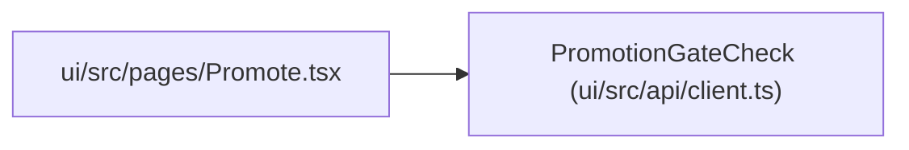

# PromotionGateCheck

**Location:** `ui/src/api/client.ts:183`
**Kind:** Class
**Bases:** —
**Module:** [client](../modules/client.md)

## Description

_Auto-generated from `PromotionGateCheck` in `ui/src/api/client.ts`._

## Attributes

| Name | Type | Required | Default | Description |
|------|------|----------|---------|-------------|
| `name` | `string` | Yes | — | — |
| `status` | `string` | Yes | — | — |
| `reason` | `string \| null` | No | — | — |
| `details` | `unknown` | No | — | — |

## Methods

*No public methods. Inherits from base classes.*

## Relationships

<!-- Auto-generated relationship summary. Do not edit by hand. -->

### Summary

| Module | Methods | Attributes |
|---|---:|---|
| [client](../modules/client.md) | 0 | `details`, `name`, `reason`, `status` |

### References

| Reference | Kind | Source | Call sites |
|---|---|---|---:|
| `Promote` | import | [Promote](../modules/Promote.md) | — |
