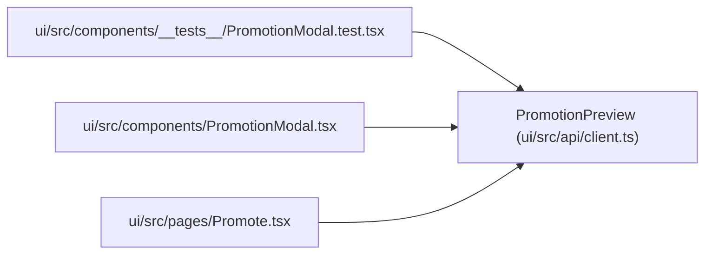

# PromotionPreview

**Location:** `ui/src/api/client.ts:149`
**Kind:** Class
**Bases:** —
**Module:** [client](../modules/client.md)

## Description

_Auto-generated from `PromotionPreview` in `ui/src/api/client.ts`._

## Attributes

| Name | Type | Required | Default | Description |
|------|------|----------|---------|-------------|
| `research_id` | `string` | Yes | — | — |
| `iteration` | `number` | Yes | — | — |
| `model_type` | `string` | No | — | — |
| `instrument` | `string` | No | — | — |
| `timeframe` | `string` | No | — | — |
| `skill_id` | `string` | No | — | — |
| `subject_id` | `string` | No | — | — |
| `variant` | `string` | No | — | — |
| `target_kind` | `string` | No | — | — |
| `scope` | `PromotionScope` | No | — | — |
| `promotion_scope` | `PromotionScope` | No | — | — |
| `promotion_allowed` | `boolean` | No | — | — |
| `scope_promotion_allowed` | `boolean` | No | — | — |
| `target_path` | `string` | Yes | — | — |
| `new_config` | `string` | Yes | — | — |
| `current_config` | `string \| null` | Yes | — | — |
| `config_snapshot_sha256` | `string` | No | — | — |
| `target_identity` | `string` | No | — | — |
| `best_metric` | `number \| null` | No | — | — |
| `training_gates_passed` | `boolean` | No | — | — |
| `gates_passed` | `boolean` | No | — | — |
| `development_gate_bundle_passed` | `boolean` | No | — | — |
| `consistency_report_passed` | `boolean` | No | — | — |
| `gate_bundle_evaluation` | `PromotionGateEvaluation \| null` | No | — | — |
| `consistency_report` | `ConsistencyReport \| null` | No | — | — |
| `development_promotion_metadata` | `Record<string, unknown> \| null` | No | — | — |
| `scoped_promotion_metadata` | `ScopedPromotionMetadata \| null` | No | — | — |
| `promotion_metadata` | `Record<string, unknown> \| null` | No | — | — |
| `scope_gate_evaluation` | `PromotionGateEvaluation \| null` | No | — | — |

## Methods

*No public methods. Inherits from base classes.*

## Relationships

<!-- Auto-generated relationship summary. Do not edit by hand. -->

### Summary

| Module | Methods | Attributes |
|---|---:|---|
| [client](../modules/client.md) | 0 | `best_metric`, `config_snapshot_sha256`, `consistency_report`, `consistency_report_passed`, `current_config`, `development_gate_bundle_passed`, `development_promotion_metadata`, `gate_bundle_evaluation`, `gates_passed`, `instrument`, `iteration`, `model_type` |

### References

| Reference | Kind | Source | Call sites |
|---|---|---|---:|
| `PromotionModal.test` | import | [PromotionModal.test](../modules/PromotionModal.test.md) | — |
| `PromotionModal` | import | [PromotionModal](../modules/PromotionModal.md) | — |
| `Promote` | import | [Promote](../modules/Promote.md) | — |
